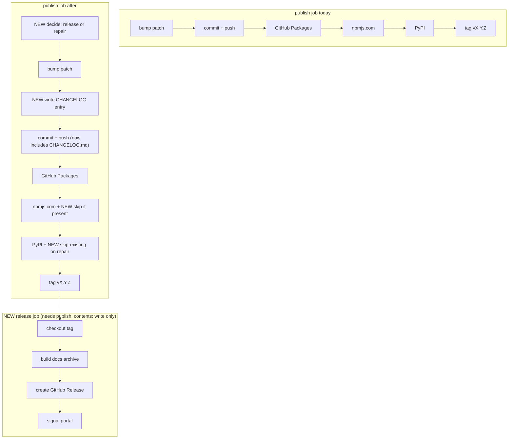

# Adopt release notes, GitHub Release with docs archive, and portal signal in the publish pipeline

## Summary in plain language

Every merge to `main` that touches library code already publishes a new version of this library (currently 2.0.21) to three package
registries. What it does not do is tell anyone **what changed**. There is no changelog file, no release page on GitHub, and no downloadable
copy of the documentation site.

This spec adds four things to the existing publish run, without changing how or where packages are published:

1. A `CHANGELOG.md` entry per version, built from the titles of the pull requests in that version.
2. A GitHub Release page for each version tag, with the documentation site attached as `docs-site.tgz`.
3. A guard so the manual trigger can finish a half-published version instead of minting a second one or failing on "already published".
4. A signal step for the developer portal, shipped switched off, because the portal cannot use it yet.

The recommendation is about 50 lines of shell inside this repo. Nothing is copied from `cli-state-handler` (the sibling repo that already
has this), because its scripts solve a different problem.

<div class="callout danger">

**Merging this change publishes one real, permanent version** (expected 2.0.22) to GitHub Packages, npmjs.com and PyPI, because the change
edits `ci-node.yml`, which is in the push path filter. That one publish is also the acceptance run. See "Rollback" for how to undo the
change without spending a further version.

</div>

## Problem

- **No record of what a version contains.** `git tag` shows 9 version tags; the newest GitHub Release marked "Latest" is `v1.1.0` from
  2025-07-29, and `v2.0.0` is still a draft. `CHANGELOG.md` does not exist.
- **The docs site is never built by automation.** No workflow references `website/` (Astro + Storybook, root script `docs:build`). The
  developer portal shows a hand-copied snapshot (see "Portal" below).
- **A failed publish cannot be repaired cleanly.** The manual trigger (`workflow_dispatch`) always bumps again, so a run that failed
  half-way leaves a version that exists on some registries and not others.

## Why now

- `cli-state-handler` adopted the same four outputs on 2026-10-09; the owner wants the two libraries to match.
- The npmjs.com publish was fixed the same day (pull request #17, merged as `974538c`), so the publish path is stable (checked: `npm view
  @montionugera/server-decorator version` on npmjs.com returns `2.0.21`; PyPI returns HTTP 200 for 2.0.21).
- The portal-side work item (follow-up (a), the joy-design docs-archive download) needs an archive to download.

## Sketch

### Decisions already made (not reopened)

This change is **additive**. GitHub Packages (GitHub's own npm registry, scope `@montionugera`) stays the primary registry. The lock-step
scheme (one version number shared by Node, Python, Go, Rust and Nim) and the patch bump on every qualifying merge stay. The npmjs.com step
and the PyPI step stay in `.github/workflows/ci-node.yml`, in the `publish` job, under `environment: pypi`: both registries use *trusted
publishing* (the registry trusts this exact repo + workflow file + environment through OIDC, a short-lived identity token, so no password is
stored), and moving or renaming them can break that trust.

### Approaches considered

| | A. Port the `cli-state-handler` scripts | B. Shared reusable workflow or package | **C. Small in-repo shell (recommended)** |
|---|---|---|---|
| New code here | ~470 lines copied (`next-release.mjs`, `lib.mjs`, tests) | ~10 lines of caller | ~50 lines: two scripts + one job |
| Fit | Poor. Its core job is choosing major/minor/patch from commit types and the feature catalog. Here the bump is always patch. Only ~18 lines (changelog prepend/extract) apply. | Good in principle, and it is what "enhance upstream, never fork" asks for. | Good. Reuses `git log`, `gh`, `tar`. |
| Cost | Forks a copy into a consumer; two copies drift. | Needs a home repo that does not exist yet, plus a rewrite of `cli-state-handler`'s working pipeline, for two consumers whose decision logic differs. | Not shared; a third consumer would repeat it. |

**Recommendation: C.** It copies nothing, so the "never fork a copy" rule is respected by not needing the upstream code at all. B is the
right move once a third consumer exists (follow-up (c), joy-design publishing `@joymify/*`, is the likely one); it is filed as a follow-up,
not built here.

A variant of C, `gh release create --generate-notes --notes-start-tag <previous tag>` (GitHub writes the notes), would need no change to the
`publish` job for notes at all. It was rejected only because it produces no `CHANGELOG.md`, and matching `cli-state-handler` (which keeps
one) is the stated goal. If the owner drops the file requirement, this variant is the smaller design.

### How notes are derived

Merges here are squash merges (one pull request becomes one commit whose title ends in `(#N)`), and each release is "everything since the
previous version tag". So the notes are the commit titles in that range, oldest first, minus the bot's own bump commits. The previous tag
is the newest version tag reachable from the checked-out commit, read before the bump:

```bash
PREV_TAG=$(git describe --tags --abbrev=0 --match 'v[0-9]*' HEAD)   # v2.0.21 on today's main (checked)
git log "$PREV_TAG..HEAD" --no-merges --reverse --format='- %s' | grep -v '^- chore: bump patch version'
```

Real output for 2.0.21 (`v2.0.20..v2.0.21`): `- fix(ci): publish to npmjs.com via trusted publishing instead of NPM_TOKEN (#17)`. GitHub
turns `(#17)` into a link on the release page. Usually a release has one line. It has more when merges that do not trigger a publish
(docs-only, for example pull request #18) sit before it. An empty range prints `- Maintenance release`. The same text is used for
`CHANGELOG.md` and the release page.

### Where the new steps go



Changes inside the existing `publish` job (file, job, `environment: pypi` and permissions unchanged; no step moved or renamed; **no new
step between the first publish and the tag**, so nothing new can fail a run after packages are out):

1. Checkout gains `fetch-depth: 0` only. Required: the notes need the previous tag and the commits since it, and the default checkout
   fetches one commit and no tags. The checked-out commit stays the triggering commit, as today.
2. **New step "Decide"**, before the bump, runs new `scripts/release-decide.sh` (about 10 lines), which prints one of:
   - `action=repair`: HEAD is the bot's bump commit (`chore: bump patch version [skip ci]`) and its version has **no tag** on origin: a
     run died before tagging and nothing has merged since. Publish that version; do not bump.
   - `action=release`: everything else. Bump as today. A manual run on a tagged `main` still forces a new version, as today.

   Required: the manual trigger is the only way to retry a publish (the workflow comment says re-running the `publish` job fails at the
   bump push), and today it always bumps, so without `repair` the skip guards in item 4 would never see an already-published version.
   Only a manual run can hit `repair`: a push run checks out its own merge commit, which is never the bot's commit. The bump, lockfile,
   changelog and commit steps get `if: steps.decide.outputs.action == 'release'`; everything else runs as today. "No tag" means
   `git ls-remote --exit-code` returned 2; any other error fails the step.
3. **New step "Write CHANGELOG entry"**, after the lockfile update, runs new `scripts/release-notes.sh <previous tag> [<end>, default
   HEAD]` and prepends `## X.Y.Z - YYYY-MM-DD` plus the lines to `CHANGELOG.md`. `CHANGELOG.md` is added to the existing `git add` list.
4. Skip guards, all edits inside existing steps. GitHub Packages needs none: `pnpm -r publish` only publishes versions not yet in the
   registry (pnpm docs). The npmjs.com loop skips a tarball when `npm view <name>@<version> version` **prints that version** (test the
   output, not the exit status, which differs between npm versions). The PyPI action gains
   `skip-existing: ${{ steps.decide.outputs.action == 'repair' }}`, so a normal release still fails loudly on a duplicate, as the action's
   README advises.

A **new job `release`** in the same file, `needs: [publish]`, `permissions: contents: write` only, no `environment`. It checks out
`needs.publish.outputs.tag` (so the tag always exists first) and reads the notes from that version's `CHANGELOG.md` section. It is a
separate job on purpose: building the docs runs Astro and Storybook dependencies, which must not run in a job that can mint registry
identity tokens, and a separate job can be re-run alone without publishing. Registry trust is unaffected: it is bound to the workflow file
name and, for PyPI, the environment, and neither publish step moves.

| Step | On failure |
|---|---|
| Decide | **Fails the run.** Nothing is published yet. |
| Write CHANGELOG entry | Warns, writes `- Release X.Y.Z`, continues. A notes bug must not block a release. |
| GitHub Packages, PyPI, tag | **Fails the run** (unchanged). |
| npmjs.com | Warns only (`continue-on-error`, unchanged). |
| `release`: build docs archive | Warns. The release is still created, without the asset. |
| `release`: create GitHub Release (`gh release create --verify-tag`, or `gh release upload --clobber` if it exists) | **Fails the `release` job.** Packages are already out; re-run this job alone. |
| `release`: signal portal | Warns only. Skipped when the secret is missing or no archive was uploaded. |

### Sequencing with the live npmjs branch

`fix/npmjs-trusted-publishing` **already landed** as pull request #17 (it looks 2 commits ahead only because of the squash merge);
`git diff origin/main fix/npmjs-trusted-publishing -- .github/workflows/ci-node.yml .github/SETUP.md` is empty. Implementation must branch
from current `origin/main` and re-run that empty-diff check first.

### Portal: what consumes these docs today

<div class="callout warn">

**Nothing downloads a release asset today.** In `joy-design`, `scripts/assemble-portal.sh` copies `website/dist` from a sibling checkout on
the same machine, or else a hand-committed copy at `apps/storybook-hub/portal-bundles/server-decorator` (197 tracked files, last refreshed
by hand in joy-design pull request #56). `apps/storybook-hub/build.js` copies that tracked folder; the `Dockerfile` only creates the empty
path. No `gh release download` exists anywhere in that repo.

</div>

So running joy-design's `ci.yml` after a release here would rebuild the portal with the **same old docs**. The signal step is therefore
shipped inert: it is identical to `cli-state-handler`'s (`gh workflow run ci.yml -R montionugera/joy-design --ref main` with the
`PORTAL_DISPATCH_TOKEN` secret), it skips with a warning while the secret is unset, and the secret is **not** to be set in this repo until
follow-up (a) teaches the portal to download `docs-site.tgz`. The secret is confirmed absent today (`gh secret list` shows only `NPM_TOKEN`
and `SLACK_WEBHOOK_URL`; `gh-secrets/secrets.yaml` has no entry for it). The absent secret is the only switch: if someone sets it early,
each release rebuilds the portal with the old docs, which is wasteful but harmless. This repo is also **private**, so the portal will need
a token that can read this repo's releases; that belongs to (a).

### README and docs task

Add a "Releases" paragraph under README "Versioning" (where notes live, what `docs-site.tgz` is, how to re-run the `release` job). Add a
"Release notes and repair" section to `.github/SETUP.md` covering the decide rule, the inert portal step and the secret. Create
`CHANGELOG.md` with a one-line header.

## Acceptance criteria

`$V` is the first version released after this lands (expected 2.0.22).

- [ ] `bash scripts/release-notes.sh v2.0.20 v2.0.21` prints exactly `- fix(ci): publish to npmjs.com via trusted publishing instead of
      NPM_TOKEN (#17)`.
- [ ] In a throwaway clone of a throwaway clone (so "origin" is local and nothing can be pushed to GitHub), `bash
      scripts/release-decide.sh` prints `action=repair` when HEAD is titled `chore: bump patch version [skip ci]` and its version has no
      tag on that origin, `action=release` once the tag exists there, and `action=release` at a normally-titled commit.
- [ ] `actionlint .github/workflows/ci-node.yml` exits 0.
- [ ] `git diff --stat origin/main...HEAD -- .github/workflows` lists only `ci-node.yml`, and `grep -c 'environment: pypi'
      .github/workflows/ci-node.yml` prints `1`.
- [ ] `gh release view v$V --json isDraft,assets --jq '[.isDraft,.assets[].name]|@csv'` prints `false,"docs-site.tgz"`.
- [ ] `git show origin/main:CHANGELOG.md | grep -c "^## $V - "` prints `1`, and `gh release view v$V --json body --jq .body | grep -c
      '^- '` prints the same count as `bash scripts/release-notes.sh v2.0.21 v$V | wc -l`.
- [ ] `gh release download v$V -p docs-site.tgz -O - | tar -tzf - | grep -c '^\./index\.html$'` prints `1`.
- [ ] With `$RUN` the id of the run that released `$V`: `gh run view $RUN --json conclusion --jq .conclusion` prints `success`, and `gh run
      view $RUN --log | grep -c 'PORTAL_DISPATCH_TOKEN is not set'` prints `1` or more.
- [ ] `npm view @montionugera/server-decorator@$V version --registry https://registry.npmjs.org` prints `$V`, and exactly one new tag
      exists: `git ls-remote --tags origin "v$V"` prints one line.
- [ ] README and `.github/SETUP.md` contain the sections named above.

## Verification plan (no accidental extra publish)

1. **Before merge, nothing can publish.** `publish` and `release` only run on `main`. Verify with the two script checks, `actionlint`, and a
   local `pnpm docs:build && tar -czf /tmp/docs-site.tgz -C website/dist .`.
2. **Never use the manual trigger (`workflow_dispatch`) to "try it".** It still bumps and publishes a real version.
3. **The merge itself is one release, by design.** The change edits `ci-node.yml`, which is in the push path filter, so merging it publishes
   `$V`. That is the one expected publish; check the criteria against it.
4. **Repair paths.** A failed `release` job: re-run only that job (`gh run rerun --job <id>`); it re-creates or re-uploads and cannot
   publish. A `publish` job that died before tagging: use the manual trigger, not a re-run. The `repair` branch is covered by the
   throwaway-clone check only; it is first exercised for real on a genuine mid-run failure.

## Rollback

- Revert the pull request. **A plain revert merge touches `ci-node.yml`, so it publishes one more permanent patch version.** To avoid
  that, put `[skip ci]` in the squash-merge title of the revert (GitHub skips push workflows for such a commit); the old workflow then
  applies from the next qualifying merge. Keep `CHANGELOG.md` when reverting.
- Versions already published stay published; nothing here can or should unpublish them.
- `gh release delete vX.Y.Z --yes` removes a release page. Never add `--cleanup-tag`: Go consumers resolve versions from the tags.

## Out of scope

- Switching the primary registry; changing the bump rule; moving, renaming or splitting the npmjs.com or PyPI steps; a `release.yml` file.
- Making the portal download the archive, and setting `PORTAL_DISPATCH_TOKEN` (follow-up (a)).
- A shared reusable release workflow (approach B). Backfilling releases for 2.0.0 to 2.0.21.
- Other backlog ideas, none of which overlap: I-011 (Go and Nim ship jobs) is the existing `smoke` job, untouched; I-029 (Rust lock-step
  bump) concerns the `git add` list, which gains one file; I-012 (multilingual docs system) is an empty skeleton.
- Filed, not chased: `.github/SETUP.md` describes `publish.yml` and `version-bump.yml`, which do not exist; merges touching only
  `python/**`, `rust/**` or `website/**` do not trigger a publish, so a docs fix reaches the archive only with the next code release; the
  `NPM_TOKEN` secret is set but no workflow reads it.

## Risks

- **Permanent publishes.** A version number on npmjs.com or PyPI can never be reused, even after deletion, and every `publish` run on `main`
  spends one. This design adds no new path that publishes; the `release` job has no registry permission.
- **Half-published version left behind.** If a run dies after GitHub Packages and a new merge lands before repair, the decide rule bumps,
  leaving the dead version partial. Deliberate: repairing would put newer code under a number GitHub Packages already holds. The guard also
  does not cover an npmjs.com-only gap: that step is warn-only, so the tag is still created and a manual run bumps.
- **Trust break by accident.** An edit that renames the workflow, the job's `environment`, or moves a publish step can make npmjs.com or
  PyPI reject the next release. The fourth acceptance check guards this.
- **Notes can miss a line.** A pull request merged in the minute between checkout and the bump push is rebased under the bump, so it ships
  in that version but its title appears in no entry (the rebase itself is today's behaviour).

## Separate follow-ups (not in this change)

None of these is needed for the four additions; each changes existing publish behaviour and deserves its own review.

- **Stop cancelling a publish on `main`.** Existing behaviour (`ci-node.yml` lines 14-16, `cancel-in-progress: true` for every ref): a
  second qualifying merge cancels a publish in flight and can leave a version half-published.
- **Check out `ref: main` in the `publish` job.** New behaviour: it would let a queued or re-run job see earlier bumps, at the price of
  always publishing the tip of `main` rather than the tested commit. Only useful together with the item above.
- **A third decide outcome, `none`** (skip bump and publishes for a queued run already released). Reachable only once both items above
  land; it addresses a queued run minting an empty version.
- **A shared reusable release workflow** (approach B), once a third consumer exists.

## UNVERIFIED

- `pnpm -r publish` skipping existing versions is documented by pnpm ("versions not yet published to the registry"); not exercised
  against GitHub Packages.
- `skip-existing` is a documented input of `pypa/gh-action-pypi-publish`, and its README names no conflict with trusted publishing; not
  exercised here, in particular not together with the attestations that trusted publishing turns on by default.
- What happens today when the `publish` job is re-run (the workflow comment says the bump push fails).
- Which Node version `website/` needs in CI, and the docs build time; the build was not run for this spec.
- The scope of `cli-state-handler`'s `PORTAL_DISPATCH_TOKEN`, and whether one token can serve both repos.
- How `--generate-notes` picks its start tag when none is given (GitHub's API docs do not say); moot unless that variant is chosen.

## Audit trail

Independent audit, 2026-10-09, against `ci-node.yml` on `origin/main`.

| Severity | Finding | What changed |
|---|---|---|
| HIGH | Turning off `cancel-in-progress` on `main` changes existing behaviour and no addition needs it. | Moved to follow-ups. |
| HIGH | `ref: main` is a new behaviour change (publish untested tip) and no addition needs it. | Moved to follow-ups; `fetch-depth: 0` kept. |
| HIGH | The `none` outcome only exists because of the two items above. | Decide reduced to release / repair; reason for `repair` stated. |
| HIGH | The one unavoidable real publish was stated only deep in the verification plan; rollback offered no way to avoid a second. | Callout added at the top; `[skip ci]` revert added. |
| MEDIUM | npmjs.com skip relied on the `npm view` exit status. | Now tests the printed version. |
| MEDIUM | Unconditional PyPI `skip-existing` hides duplicates on normal releases. | Limited to `repair`. |
| MEDIUM | `release-notes.sh` had one argument in the design and two in the criteria; previous tag undefined. | Signature and `git describe` rule stated. |
| MEDIUM | Two criteria were not runnable commands; the decide check could reach the real origin. | Rewritten as commands against a local origin. |
| LOW | Two UNVERIFIED items resolvable from docs. | Resolved to "documented, not exercised". |
