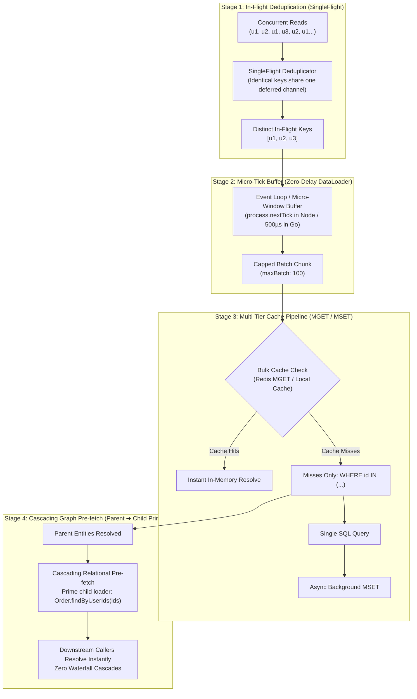

# Reactive Call Coalescing Pipeline: Micro-Batching, SingleFlight, Multi-Tier MGET, and Graph Pre-fetching

## Problem

Modern microservices frequently suffer from catastrophic I/O amplification across multi-tiered data access layers:
1. **N+1 Query Explosions**: Fetching related entities across service or database boundaries results in serial network round-trips ($O(N)$ overhead), choking database connection pools and inflating p99 tail latency.
2. **Thundering Herds & Stampedes**: Sudden concurrent traffic spikes requesting the exact same hot keys cause duplicate in-flight queries to hammer storage engines.
3. **Cache Socket Saturation**: Conventional `@cache` implementations evaluate keys sequentially (`GET key_1`, `GET key_2`), multiplying TCP packet overhead instead of leveraging bulk pipeline protocols (`MGET`).
4. **Relational Waterfall Cascades**: Resolving a collection of parent entities triggers secondary cascades of child-entity lookups ($1 \to N \to M$), compounding latency at each depth level.

## Why now

- In `v2.0` – `v2.2`, `node-server-decorator` established cross-language entity models, polyglot transports (Express, FastAPI, Gin), and resilience decorators (`@cache`, `@retry`, `@circuit_breaker`, `@rate_limit`).
- Chaining these capabilities into a unified **Reactive Coalescing Pipeline** (`coalesce.Pipeline` in Go, `@batchChain` / `@batchLoad` in TypeScript & Python) will unlock $10\times$ to $50\times$ database throughput gains without forcing application developers to manually rewrite imperative batch queries.

---

## The 4-Stage Coalescing Chain Architecture

---

## Detailed Chain Specifications

### Link 1: In-Flight Deduplication (`SingleFlight`)
- Intercepts incoming lookups before queueing.
- If $K$ callers request key `X` simultaneously, only **one** instance of `X` enters the batch. All $K$ callers subscribe to the same deferred result channel/future.
- Prevents database stampedes for hot keys.

### Link 2: Micro-Tick Event-Loop Buffer (`Zero-Delay Window`)
- **Node.js**: Leverages `queueMicrotask` / `process.nextTick`. Batches all queries triggered during the current synchronous execution turn with **0ms artificial delay**.
- **Go**: Uses a high-resolution timer (`500µs` - `2ms`) combined with a `maxBatchSize` ceiling and immediate dispatch if context deadlines are near.
- **Strict Anti-Starvation Rule**: Debouncing is strictly prohibited. Fixed-window ticks guarantee bounded latency.

### Link 3: Hybrid Cache Pipeline (`MGET` Filtering)
- Instead of wrapping individual calls with single-key `@cache`, the coalescer evaluates the entire batch at the cache boundary.
- Executes bulk `MGET key_1 key_2 ... key_n`.
- Resolves cache hits immediately.
- Forwards **only cache misses** to the underlying batch database query (`WHERE id IN (...)`).
- Asynchronously backfills newly resolved records into cache via bulk `MSET`.

### Link 4: Cascading Graph Pre-Fetching (`Parent ➔ Child Priming`)
- When a batch of parent entities is resolved (e.g. `Users [u1, u2, u3]`), the pipeline can declaratively notify registered child loaders (e.g. `OrdersLoader.prime(...)`).
- When downstream business logic iterates over users and calls `orderRepo.findByUserId(user.id)`, the order data is either already fetched or resolving concurrently in the background, eliminating relational waterfall cascades ($O(1)$ round-trips instead of $O(N)$).

---

## Polyglot Implementation Boundaries

1. **Go Core (`go/core/coalesce`)**:
   - 100% pure standard library (zero external dependencies).
   - Generic `coalesce.Loader[K comparable, V any]` and `coalesce.Pipeline[K comparable, V any]`.
   - Context cancellation isolation: cancelling one caller's `ctx` unsubscribes that caller without killing the underlying batch execution for other callers.

2. **TypeScript / Node (`@montionugera/server-decorator`)**:
   - `@batchLoad({ batchMethod, maxBatchSize, windowMs, cachePipeline, cascade })`.
   - Built-in request-scoped AsyncLocalStorage isolation to prevent data leaks across tenant boundaries.

3. **Python Core (`server_decorator.coalesce`)**:
   - Asyncio-native batch queuing integrated into the event loop.

4. **Safety & Transactional Guardrails**:
   - **Reads Only**: Write operations are strictly banned from transparent coalescing to prevent ACID boundary violations and partial failure ambiguity. Bulk writes must remain explicit via `saveAll()`.
