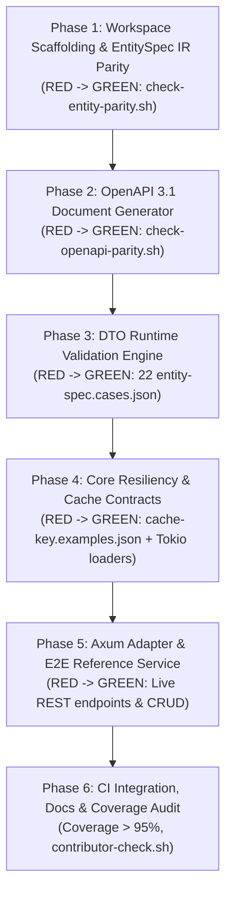

# Rust Lane Implementation Plan: `server-decorator-rust`

**File**: `docs/superpowers/plans/rust-support-plan.md`  
**Spec Reference**: `docs/superpowers/specs/rust-support-design.md`  
**Execution Mode**: Subagent-Driven / OpenUltraCode (Strict Phased Quality Gate + TDD)  
**Coverage Target**: > 95% line coverage  
**Parity Verification**: Byte-identical to `entity-spec.valid-user.json` & `openapi.valid-user.json`  

---

## 1. Quality Gates & Fidelity Tiers

Every phase MUST adhere to the **Phased Quality Gate**:
1. **Implement (TDD RED -> GREEN)**: Write failing tests against contract fixtures first, then implement minimal code to pass.
2. **Verify**: Execute verification command with fresh visible output. No "should work".
3. **Review**: Adversarial code review check against security, memory safety, and boundary edge cases.
4. **Refactor**: Clean up dead code, redundant allocations, simplify types.
5. **Re-verify**: Re-run verification command to confirm no regressions.

### Target Fidelity Tiers
- **Tier 1 (Domain & Metaprogramming)**: `server-decorator-entity` data types, fluent builder, and canonical JSON serialization.
- **Tier 2 (Schema & Validation)**: `server-decorator-openapi` (OpenAPI 3.1 byte parity) & `server-decorator-dto` (22 contract cases).
- **Tier 3 (Resiliency & Messaging Core)**: `server-decorator-core` (cache key hasher, CacheAdapter, Retry, CircuitBreaker, RateLimit, Coalesce Loader, QueueMessage, W3C TraceContext).
- **Tier 4 (Live Runtime Delivery & E2E)**: `server-decorator-axum` and `examples/axum-entity-server` with live HTTP request assertions and >95% test coverage.
- **Tier 5 (Tooling & Documentation)**: Integration into `scripts/check-entity-parity.sh`, `scripts/check-openapi-parity.sh`, `scripts/check-versions.sh`, `scripts/contributor-check.sh`, and Starlight portal.

---

## 2. Phase Breakdown



---

### Phase 1: Workspace Scaffolding & EntitySpec IR Parity (Tier 1)

- **Goal**: Create `rust/` workspace and implement `server-decorator-entity` with fluent builder and byte-identical canonical JSON serialization.
- **Tasks**:
  1. Initialize `rust/Cargo.toml` with workspace crates (`server-decorator-entity`, `server-decorator-core`, etc.).
  2. Implement `EntitySpec`, `FieldSpec`, `ActionSpec`, `SecuritySpec` structs with Serde.
  3. Implement `canonical.rs` using `BTreeMap<String, Value>` to enforce lexicographical sorting, omit defaults, and compact separators.
  4. Implement `UserSpec` in `rust/crates/server-decorator-entity/examples/user.rs`.
  5. Add `rust/crates/server-decorator-entity/bin/emit-fixture.rs`.
  6. Connect to `scripts/check-entity-parity.sh`.
- **Verification Command**:
  ```bash
  (cd rust && cargo run --package server-decorator-entity --bin emit-fixture) | diff -u - contracts/fixtures/entity-spec.valid-user.json
  ```
- **Acceptance Criteria**: `diff` exits 0 with zero differences.

---

### Phase 2: OpenAPI 3.1 Document Generator (Tier 2)

- **Goal**: Implement `server-decorator-openapi` emitting byte-identical OpenAPI 3.1 JSON matching `contracts/fixtures/openapi.valid-user.json`.
- **Tasks**:
  1. Scaffolding `server-decorator-openapi` crate.
  2. Map field types (`str`, `ref`, `int`, `float`, `bool`, `datetime`, `enum`, `list`, `obj`) to JSON Schema 2020-12 / OpenAPI 3.1.
  3. Generate paths (`/{path}`, `/{path}/{id}`, `/{path}/{id}/{action}`).
  4. Generate components and schema variants (`Read`, `Create`, `Update`, Action inputs).
  5. Generate security schemes (Bearer JWT).
  6. Add `rust/crates/server-decorator-openapi/bin/emit-openapi.rs`.
  7. Connect to `scripts/check-openapi-parity.sh`.
- **Verification Command**:
  ```bash
  (cd rust && cargo run --package server-decorator-openapi --bin emit-openapi) | diff -u - contracts/fixtures/openapi.valid-user.json
  ```
- **Acceptance Criteria**: `diff` exits 0 with zero differences.

---

### Phase 3: DTO Runtime Validation Engine (Tier 2)

- **Goal**: Implement `server-decorator-dto` and validate all 22 test cases in `contracts/fixtures/entity-spec.cases.json`.
- **Tasks**:
  1. Scaffolding `server-decorator-dto` crate.
  2. Implement validation predicates for `create`, `update`, `read`, and actions.
  3. Implement email, uuid, uri, and custom regex validation (RE2/rust-regex compatible).
  4. Implement strict type checking (reject string for numbers/bools; accept `5.0` for int; reject naive datetimes and epoch integers).
  5. Implement `cases_test.rs` loading `contracts/fixtures/entity-spec.cases.json`.
- **Verification Command**:
  ```bash
  cd rust && cargo test --package server-decorator-dto
  ```
- **Acceptance Criteria**: 22/22 contract cases pass with exact error field path matches.

---

### Phase 4: Core Resiliency & Cache Contracts (Tier 3)

- **Goal**: Implement `server-decorator-core` with deterministic cache key hashing, CacheAdapter, Retry, CircuitBreaker, RateLimit, Coalesce Loader, and QueueMessage.
- **Tasks**:
  1. Implement `build_cache_key` and test against `contracts/fixtures/cache-key.examples.json`.
  2. Implement `CacheAdapter` async trait with `CACHE_MISS` sentinel enum.
  3. Implement `Retry` with exponential backoff and jitter.
  4. Implement `CircuitBreaker` state machine (Closed, Open, HalfOpen).
  5. Implement `RateLimiter` (token bucket).
  6. Implement `BatchLoader` (Tokio-native DataLoader coalescing requests).
  7. Implement `QueueMessage` and W3C `traceparent` extraction/injection.
- **Verification Command**:
  ```bash
  cd rust && cargo test --package server-decorator-core
  ```
- **Acceptance Criteria**: All golden cache key fixtures match; concurrent batch loader correctly coalesces.

---

### Phase 5: Axum Adapter & E2E Reference Service (Tier 4)

- **Goal**: Implement `server-decorator-axum` and create a complete runnable `axum-entity-server` with REST CRUD, action handling, problem details, and E2E tests.
- **Tasks**:
  1. Implement `server-decorator-axum` router builder.
  2. Implement RFC 9457 Problem Details error responses.
  3. Create `examples/axum-entity-server` with in-memory User repository.
  4. Write comprehensive integration tests using `tower::ServiceExt` / `reqwest`.
- **Verification Command**:
  ```bash
  cd rust && cargo test --package axum-entity-server
  ```
- **Acceptance Criteria**: All CRUD endpoints, pagination, filtering, action transitions, and error handling pass with live request/response verification.

---

### Phase 6: CI Integration, Documentation & Coverage Audit (Tier 5)

- **Goal**: Plug Rust into the main repository quality gates, verify >95% code coverage, and update documentation.
- **Tasks**:
  1. Update `scripts/check-entity-parity.sh` to include Rust.
  2. Update `scripts/check-openapi-parity.sh` to include Rust.
  3. Update `scripts/check-versions.sh` to verify `Cargo.toml` version lockstep.
  4. Update `scripts/contributor-check.sh` to run `cargo test --workspace`.
  5. Add Rust code switcher tabs to `website/` documentation.
  6. Run coverage analysis ensuring **line coverage > 95%**.
- **Verification Command**:
  ```bash
  bash scripts/contributor-check.sh
  ```
- **Acceptance Criteria**: All contributor gates pass cleanly, including parity checks and Rust workspace tests.
