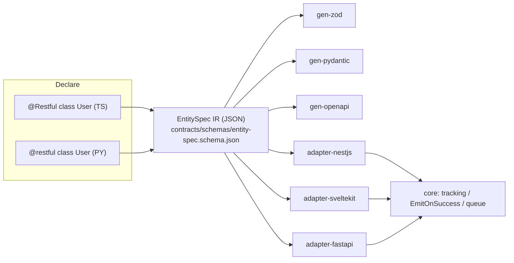

# Entity-Spec Framework — Design

**Idea:** I-004 · **Date:** 2026-08-04 · **Status:** Approved by Mont (brainstorm 2026-08-03/04)
**Repo:** node-server-decorator (becomes a layered monorepo)

## 1. Problem

Every service in the estate hand-writes the same per-entity stack: entity + DTOs + controller + module registration + validation decorators + swagger annotations + observability wiring. A survey (2026-08-03) across user-svc, content-svc, file-svc, message-svc, goodname-v2, and fact-board found:

- **~3,500–4,000 lines** of mechanically generatable boilerplate across ~10 entities. Worst case: `content-svc/real-estate-project.dto.ts` — 417 lines, 93 validator decorators, 26 `@ApiProperty`.
- **7 near-identical state-trigger routes** in fact-board (`approve`, `reject`, `post-now`, …): the same 40-line zod-parse → 409-guard → transaction skeleton, copied.
- **~1,800 lines of per-service infra** (metrics/logging interceptors, custom validators, JWT guard stanzas, swagger bootstrap) copy-pasted across the 4 NestJS services — and **already drifting** (message-svc forked `EmitOnSuccess` locally; `unique.validator.ts` diverged between content-svc and message-svc).

Goal: **declare system behavior instead of implementing it.** Decorate an entity once; get REST CRUD, RPC state triggers, SSE change streams, WebSocket, validation, docs, and observability — identically in Node and Python.

```ts
@Restful({ path: "users", transports: ["rest", "rpc", "sse", "ws"] })
class User {
  @id() id: string;
  @email() email: string;
  @str({ min: 2, max: 80 }) name: string;
  @enumOf(["inactive", "active", "banned"]) status: string;

  @action("activate", { from: "inactive", to: "active" })
  async activate(ctx: ActionCtx) {}
}
```

## 2. Locked decisions (brainstorm 2026-08-03/04)

| # | Decision | Choice |
|---|---|---|
| E1 | Runtime base | **Adapter over existing frameworks** — decorators emit a neutral spec; adapters mount it into NestJS / SvelteKit / FastAPI. Not a standalone server, not a codegen tool. |
| E2 | Persistence | **Repository port** — framework defines `EntityRepo<T>`; consumers register one impl per entity. ORM-agnostic. In-memory repo ships for tests; Prisma/TypeORM examples in docs only. |
| E3 | v1 transports | **All four** (REST+validation, RPC state triggers, SSE, WS), phased in that order. SSE has zero current usage in the estate — sequenced after REST/RPC. |
| E4 | Home | **Monorepo restructure of node-server-decorator.** Supersedes original Decision #11 ("no monorepo tooling", 2026-05-05) — requires ADR (see §10). |
| E5 | v1 adapters | **NestJS + FastAPI + SvelteKit.** Django/DRF deferred (DRF already covers most of this natively). |
| E6 | Pilot | **content-svc** (`RealEstateProject` + `RealEstateListing`, ~1,100 generatable lines). Second pilot: fact-board's trigger routes. Third: message-svc WS. |
| E7 | Core mechanism | **EntitySpec IR compiler** — decorators only record metadata into a language-neutral IR; all behavior is generated from the IR. Validation compiles to zod (Node) / pydantic (Python) — no home-grown validator engine. |

## 3. Architecture

The IR is the single source of truth. Decorators are thin recorders; generators and adapters are backends.



**Parity is mechanical:** the same fixture entity declared in TS and Python must serialize to **byte-identical IR JSON**, validated against the schema in `contracts/` — same pattern as the existing cache-key parity tests.

### Package layout

```
node-server-decorator/
├── contracts/
│   ├── schemas/entity-spec.schema.json     # THE contract, versioned
│   └── fixtures/entity-spec/*.json         # parity + TCK fixtures
├── node/                                    # pnpm workspace
│   └── packages/
│       ├── core/               # existing @cache @tracking @EmitOnSuccess (API unchanged)
│       ├── entity/             # @Restful, field decorators, @action → IR
│       ├── gen-zod/            # IR → zod schemas
│       ├── gen-openapi/        # IR → OpenAPI
│       ├── adapter-nestjs/     # IR → controllers/gateways + pipes/interceptors
│       └── adapter-sveltekit/  # IR → +server.ts handler factories
└── python/                                  # uv workspace
    └── packages/
        ├── core/               # existing cache/tracking/emit_on_success
        ├── entity/             # @restful, field types, @action → same IR
        ├── gen-pydantic/       # IR → pydantic models
        └── adapter-fastapi/    # IR → APIRouter incl. SSE/WS
```

**Layering rule (strict, one direction):** `entity` depends on nothing → generators depend on `entity` only → adapters depend on `entity` + generators + `core`. Adapters wire core tracking/emit automatically; SSE/WS consume the events emitted by generated writes.

**Consumers install only what they use.** Existing `@montionugera/server-decorator` consumers (message-svc) are unaffected — `core`'s API does not change.

## 4. IR contents (v1, closed list)

- **Fields:** name, type (`str | int | float | bool | datetime | enum | ref | list | obj`), constraints (min/max/pattern/format), flags (`readonly`, `writeonly`, `optional`, `nullable`, `filterable`).
- **Casing policy:** IR and wire are always camelCase; Python declarations are snake_case with automatic mapping (pydantic alias style).
- **Entity options:** path, transports, pagination (`cursor | offset`), enabled ops (subset of `list/get/create/update/delete`), `public` flags per op.
- **Actions:** name, optional state machine (`field` — default `status`, `from`, `to`), input schema, transactional (default true).
- **Derived (never declared):** DTOs — Create = writable fields, Update = partial writable, Read = non-writeonly; event topics `User.created/updated/deleted/<action>ed`; OpenAPI operation ids; SSE/WS channel names.

### Escape hatches (non-negotiable)

1. Any generated route can be overridden by hand-writing that endpoint; the adapter detects and skips it.
2. `entitySpec(User)` returns the raw IR object for fully custom use.

### Repository port

```ts
interface EntityRepo<T> {
  get(id: Id): Promise<T | null>;
  list(query: ListQuery): Promise<Page<T>>;     // filters/sort/cursor derived from IR
  create(data: CreateDto<T>): Promise<T>;
  update(id: Id, patch: UpdateDto<T>): Promise<T>;
  transition(id: Id, action: string, patch?: Partial<T>): Promise<T>;  // atomic; 409 guard lives here
  delete(id: Id): Promise<void>;
}
```

## 5. Transport behavior (data flow)

All transports share one generated pipeline:

```
request → auth guard → validate (zod/pydantic) → repo → serialize (Read DTO) → respond
                              ↓ on write success
                    emit event via core EmitOnSuccess
                              ↓
                    SSE + WS subscribers (topic User.updated …)
```

- **REST:** `GET /users` (paginated), `GET /users/:id`, `POST`, `PATCH` (partial; no PUT in v1), `DELETE`. List filtering only on `@filterable()` fields — allowlist, never open filtering.
- **RPC state triggers:** `POST /users/:id/actions/activate` → parse → load → state guard (`status !== from` → 409 incl. `currentState`) → action body inside `repo.transition()` → emit. Non-state actions are plain validated RPC endpoints.
- **SSE:** `GET /users/events` — bridges core emitter/queue to the stream; 15s heartbeat; `Last-Event-ID` reconnect with **best-effort in-memory ring-buffer replay** (durable replay = v2, documented limitation).
- **WebSocket:** one namespace per entity (`/ws/users`); messages `subscribe` (same events as SSE) and `invoke` (same pipeline as RPC, same 409 semantics). WS is thin framing only — no logic of its own. Redis fan-out reuses the message-svc adapter pattern.
- **Standard middleware (collapses the ~1,800 duplicated lines):** request-id + structured logging, Prometheus `http_requests_total` / duration histogram (same metric names already exported → dashboards keep working), core tracking on every handler. Auth via a per-adapter `guard` hook (NestJS guard class / SvelteKit `locals` check / FastAPI dependency), mounted on everything except `public: true` ops.

## 6. Error contract (one shape, all transports)

Wire format (in `contracts/`): `{ "error": { "code", "message", "details?", "requestId" } }`.

| Code | HTTP | Notes |
|---|---|---|
| `VALIDATION_FAILED` | 400 | per-field details |
| `NOT_FOUND` | 404 | |
| `INVALID_STATE` | 409 | includes `currentState` |
| `CONFLICT` | 409 | repo-reported uniqueness |
| `UNAUTHORIZED` / `FORBIDDEN` | 401 / 403 | |
| `INTERNAL` | 500 | message redacted; logged with requestId |

- Repos raise typed errors (`RepoConflict`, `RepoNotFound`); anything untyped → 500.
- Action bodies may throw `DomainError(code, message)` → controlled 4xx.
- Emit failures never fail the request (core rule); logged + `entity_emit_failures_total` metric.
- SSE/WS deliver errors as a terminal `error` event, same shape.

## 7. Testing strategy

1. **Unit** — per package: metadata collection, IR building, generator outputs.
2. **Contract parity (the spine)** — fixture entities in TS and Python → byte-identical IR JSON, schema-validated in the existing `ci-contracts` lane. Drift fails CI.
3. **Adapter conformance kit (TCK)** — one data-driven suite in `contracts/fixtures/` (create → 201; bad email → 400 shape; wrong-state action → 409 + `currentState`; SSE receives `updated`; …). Every adapter must pass the identical suite against the in-memory repo. New adapter = pass the TCK.
4. **Integration** — testcontainers (existing pattern): Redis WS fan-out, queue-fed SSE.
5. **Pilot proof** — snapshot content-svc's current OpenAPI + response behavior, migrate the two entities, assert snapshots match, then delete ~1,100 lines.

## 8. Rollout phases

Each phase ends with the standard quality gate (verify → independent review → refactor → re-verify).

| Phase | Deliverable | Proof |
|---|---|---|
| P0 | ADR superseding Decision #11 + monorepo restructure (pnpm/uv workspaces; no new features) | existing tests still green; packages publish |
| P1 | `entity` + IR + `contracts/entity-spec` + gen-zod/gen-pydantic | parity tests green before any HTTP exists |
| P2 | adapter-nestjs (REST + middleware/observability) + TCK | **pilot: content-svc migration** |
| P3 | RPC actions + adapter-sveltekit | second pilot: fact-board's 7 trigger routes |
| P4 | SSE + WS on the event layer | TCK extended; Redis fan-out integration test |
| P5 | adapter-fastapi passes same TCK + cross-language interop | `ci-interop` lane green |

## 9. Risks

- **IR schema is load-bearing** — versioned like existing contracts; additive changes only within a major; generous use of optional fields early (tighten later).
- **Decorator metadata limits (TS)** — mitigated by explicit field decorators (no reliance on `emitDecoratorMetadata` type inference).
- **Two-language surface drift** — the exact failure the parity fixtures + TCK exist to catch mechanically.
- **Pilot regression risk (content-svc)** — OpenAPI/behavior snapshots taken before migration; migration is per-entity and reversible (old controller kept until snapshot parity is proven).
- **Scope gravity** — v1 IR is a closed list; anything not in §4 goes through the escape hatches, not new IR features.

## 10. ADR required

`docs/adr/0006-monorepo-restructure.md`: supersedes Decision #11 (2026-05-05, "two folders, no monorepo tool"). Rationale: the entity layer multiplies the package count (entity, generators, N adapters × 2 languages); publishing them as one blob couples consumers to adapters they don't use. pnpm workspace (Node) + uv workspace (Python); lockstep versioning (Decision #2) is retained across all published packages.

## 11. Open items

- Naming: working name `entity-spec` for the new layer; package scope stays `@montionugera/*`. Final names before P0 publishes.
- SSE durable replay (queue-backed `Last-Event-ID`) — explicitly v2.
- Django/DRF adapter — deferred; revisit after P5.
