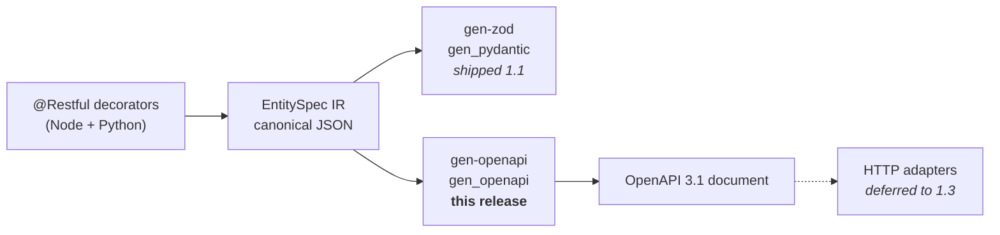

# REST API delivery layer, part 1: OpenAPI generator — design

**Idea:** I-005 · **Release:** 1.2 · **Date:** 2026-08-15 · **Status:** approved

## Goal

Make the EntitySpec IR emit a byte-identical OpenAPI 3.1 document from both Node and
Python, and extend the IR with the documentation and authorization metadata that a usable
API description requires.

## Why this, and why now

The entity-spec layer shipped in release 1.1 stops at DTO validators. `@Restful` records
`path`, `ops`, `pagination`, `filterable`, `ref` and `actions`, but **nothing consumes
them** — there is no HTTP layer of any kind. The gap between "declare an entity" and
"serve a REST API" is currently the whole delivery half of the problem.

<div class="callout info">
<strong>Sequencing decision.</strong> The OpenAPI generator lands <em>before</em> any HTTP
adapter. The generated document becomes the machine-readable statement of the URL shapes,
status codes, pagination envelopes and error bodies — so when the Express and FastAPI
adapters arrive in 1.3, the document is the conformance test they are checked against and
they cannot drift from each other.
</div>

## Non-goals

Explicitly deferred, and not to be smuggled in:

- **All HTTP adapters** — Express, Fastify, Nest, FastAPI, Starlette.
- **The repository / persistence port.**
- **`rpc`, `sse`, `ws` transports** — they remain unimplemented members of the type union.
- **`ref` relation expansion** — `ref` fields emit as their scalar id type; no `$ref`
  chasing, no embedded-resource expansion.
- **Runtime auth enforcement** — the contract declares requirements; it never checks them.
- **Object-level / ownership authorization** — "only the owner may update this record"
  depends on the loaded row and the caller identity at request time. A static document
  declares one requirement per operation and has nowhere to express a per-instance
  relationship. This belongs in an adapter or handler, permanently, not in the contract.

## Architecture



Two new packages, peers of the existing DTO generators:

| Package | Language | Distribution name |
| --- | --- | --- |
| `node/packages/gen-openapi` | Node | `@montionugera/entity-spec-gen-openapi` |
| `python/packages/gen_openapi` | Python | `server-decorator-gen-openapi` |

Both are **pure functions over the IR** — no HTTP framework dependency, no runtime, no I/O.

**Public surface (identical semantics in both languages):**

- `openapiDocument(specs) -> document` — the whole API from a list of entity specs.
- `openapiPaths(spec) -> paths object` — one entity's routes, for composition.
- `openapiComponents(spec) -> schemas + securitySchemes` — one entity's components.

**Layering rule, unchanged:** `entity` -> `gen-*` -> adapters. `gen-openapi` depends only
on its own language's `entity` package. It must never import `core`, the other language,
or another `gen-*` package.

## Contract change: `contracts/VERSION` 1.1.0 -> 1.2.0

All additions are **optional**, so every existing declaration remains valid and every
existing golden fixture keeps passing. `specVersion` in the IR moves to `1.2.0`.

### New IR fields

| Level | Field | Type | Purpose |
| --- | --- | --- | --- |
| Entity | `description` | string | Prose describing the resource |
| Entity | `tags` | string[] | OpenAPI grouping |
| Entity | `security` | object | Schemes + per-operation scope requirements |
| Field | `description` | string | Prose describing the property |
| Action | `description` | string | Prose describing the transition |

### The `security` object

```json
{
  "security": {
    "schemes": [
      { "name": "bearerAuth", "type": "http", "scheme": "bearer", "bearerFormat": "JWT" }
    ],
    "ops":     { "list": ["user:read"], "create": ["user:write"] },
    "actions": { "activate": ["user:admin"] }
  }
}
```

- `type` is a **closed enum**: `http` | `apiKey`. Nothing else validates.
- `http` requires `scheme` (`bearer` | `basic`); `bearerFormat` is optional.
- `apiKey` requires `in` (`header` | `query` | `cookie`) and `paramName`.
- `ops` keys are constrained to the entity's declared `ops`; `actions` keys to its declared
  action names. A key naming an operation the entity does not expose is a validation error.
- An operation absent from `ops` is **public**. An operation present with `[]` requires
  authentication but no particular scope.

<div class="callout warn">
<strong>The contract declares what is required, never how it is checked.</strong> Scope
strings are opaque to the contract — no role hierarchy, no wildcard expansion, no implied
containment. This is what keeps the model language-neutral: enforcement lives in a future
adapter or an upstream gateway, and consumers using ABAC or a policy engine can map scopes
onto their own model without the contract fighting them.
</div>

### Scope string convention

Scope strings are opaque to the contract, but the convention is binding on this repo's own
fixtures and examples: **use permission strings, not role names.**

| Form | Example | Use it? |
| --- | --- | --- |
| Permission — what may be done | `user:write` | **Yes.** Stable, deployment-neutral |
| Role — who the caller is | `superadmin` | No. Roles are deployment-specific and churn |
| Relationship — caller vs this record | `owner` | Never. Not expressible; see non-goals |

The intended layering keeps roles out of the wire format entirely:

```
identity provider   alice has role "superadmin"
        v           role expands to permissions when the token is minted
token scopes        ["user:read", "user:write", "user:delete"]
        v
this contract       create requires ["user:write"]
        v
adapter (1.3+)      does the token carry every required scope?
```

`superadmin` never appears in an EntitySpec. It is a role that grants many scopes, resolved
upstream. Naming roles in the contract would assert an authorization model that consumers
with a different model cannot use — the same reason ADR 0008 chooses scopes over roles.


### Decorator surface

```ts
// Node
@Restful({
  path: 'users',
  description: 'A registered user account',
  tags: ['identity'],
  security: { schemes: [{ name: 'bearerAuth', type: 'http', scheme: 'bearer' }],
              ops: { create: ['user:write'] } },
})
class User {
  @email({ filterable: true, description: 'Primary contact address' }) email!: string;

  @action('activate', { from: 'inactive', to: 'active',
                        description: 'Move a dormant account back to active' })
  activate(): void {}
}
```

```python
# Python — same fields, same validation, snake_case call style
@restful(
    path="users",
    description="A registered user account",
    tags=["identity"],
    security={"schemes": [{"name": "bearerAuth", "type": "http", "scheme": "bearer"}],
              "ops": {"create": ["user:write"]}},
)
class User: ...
```

### Files that must change together in one PR

`contracts/VERSION` · `contracts/schemas/entity-spec.schema.json` ·
`contracts/CHANGELOG.md` · `node/packages/core/src/_contract.ts` ·
`python/packages/core/src/server_decorator/_contract.py` · both `entity` packages ·
all affected fixtures. `ci-contracts.yml` fails the build otherwise.

## REST conventions — `contracts/rules/rest-conventions.md`

A new rule document alongside `cache-key.md` and `topic-naming.md`, binding on every
future adapter.

| IR op | Method + path | Success | Request body | Response body |
| --- | --- | --- | --- | --- |
| `list` | `GET /{path}` | 200 | — | list envelope |
| `get` | `GET /{path}/{id}` | 200 | — | read DTO |
| `create` | `POST /{path}` | 201 | create DTO | read DTO |
| `update` | `PATCH /{path}/{id}` | 200 | update DTO | read DTO |
| `delete` | `DELETE /{path}/{id}` | 204 | — | empty |
| action | `POST /{path}/{id}/actions/{name}` | 200 | action-input DTO | read DTO |

`update` is **PATCH, not PUT** — the existing `updateSchema()` derives a partial schema, so
PATCH is the semantically honest verb. There is no PUT route.

### Pagination

- `pagination: "offset"` -> query `limit`, `offset`; envelope
  `{ "items": [...], "total": n, "limit": n, "offset": n }`.
- `pagination: "cursor"` -> query `limit`, `cursor`; envelope
  `{ "items": [...], "nextCursor": "..." | null }`.
- `limit` documents a default of 20 and a maximum of 100.

### Filtering

Every field marked `filterable` becomes an optional query parameter on `list`, typed from
the field's own type and constraints. Enum fields document their allowed values.

### Errors — RFC 9457 problem+json

Every non-2xx response is `application/problem+json`:

| Status | When |
| --- | --- |
| 400 | Request body or query fails DTO validation |
| 401 | Operation declares scopes; credentials absent or invalid |
| 403 | Authenticated, but declared scopes not held |
| 404 | Resource id not found |
| 409 | Action invoked from a state its `from` does not permit |

The 400 body carries an additional `fields` array — the same sorted field-path list that
`validationErrorFields()` already produces in `gen-zod`, so the error contract and the
validators stay consistent by construction.

## Parity: byte-identical, enforced

<div class="callout success">
<strong>Same mechanism the entity layer already proves.</strong> Node and Python must emit
the identical canonical JSON document for the identical input, checked against a committed
golden file — not merely "semantically equivalent" documents.
</div>

- **Golden file:** `contracts/fixtures/openapi.valid-user.json`, generated from the existing
  `UserFixture` (extended with descriptions, tags and security to exercise the new fields).
- **New script:** `scripts/check-openapi-parity.sh`, mirroring `check-entity-parity.sh` —
  emit from Node, emit from Python, assert both equal the golden byte for byte, diff on
  failure.
- **Key ordering:** reuses the existing `canonicalJson` (Node) and `canonical.py` (Python).
  No new canonicalization logic is written.

## Testing

| Layer | Check |
| --- | --- |
| Unit, both languages | Each `gen-openapi` compiled against the shared `contracts/fixtures/entity-spec.cases.json`, as the DTO generators already are |
| Schema validity | `contracts/scripts/validate.sh` gains a check that the golden document validates against the **OpenAPI 3.1 meta-schema** |
| Cross-language | `check-openapi-parity.sh` joins CI as a third parity gate |
| Regression | Existing entity-spec and DTO fixtures must keep passing unchanged, proving the IR additions are genuinely additive |

Coverage must include: every op combination (entities exposing a subset of `ops`), both
pagination modes, filterable fields of each type, actions with and without input, entities
with no security block, and nested `obj`/`list` fields.

## Folded-in work

### ADR 0008 — authorization metadata in the wire contract

Required by `CLAUDE.md`: locked design decisions change only via a new ADR. Records why
scopes rather than roles (roles bake an authorization *model* into a wire format that
consumers with a different model cannot use), why the scheme enum is closed, and why
enforcement is explicitly excluded.

### Build-order fix

`pnpm -r test:unit` **fails on a clean checkout today**: `gen-zod` imports
`@montionugera/entity-spec`, which resolves through `dist/`, so the build must run first —
yet `CLAUDE.md` documents that command as the fast feedback loop.

This is in scope because `gen-openapi` is a fourth package importing `entity` the same way
and would hit the identical failure. Fix once, properly:

- Add an `exports` map to the `entity` package with an explicit `./testing` subpath, so
  consumers stop deep-importing `dist/testing/user-fixture`.
- Make the unit lane build its workspace dependencies first.
- Correct the command table in `CLAUDE.md`.

## Acceptance criteria

1. `bash scripts/check-openapi-parity.sh` passes — Node output == Python output == golden.
2. The golden document validates against the OpenAPI 3.1 meta-schema.
3. `contracts/VERSION`, `_contract.ts` and `_contract.py` all read `1.2.0`; `ci-contracts.yml` green.
4. Every 1.1 fixture still passes untouched.
5. `bash scripts/check-versions.sh` passes — all eight packages at one version.
6. `pnpm -r test:unit` passes from a clean checkout with no manual build step.
7. `cd python && bash scripts/check.sh` passes — ruff, ruff format, mypy strict, pytest.
8. Both new packages are published by the existing release lanes.
9. ADR 0008 committed under `docs/adr/`.

## Risks

| Risk | Mitigation |
| --- | --- |
| Byte-identical JSON across two languages is exacting | Reuse the proven `canonicalJson` / `canonical.py`; the entity layer already clears this bar |
| Auth metadata bakes a bad assumption into a wire contract | Closed scheme enum, opaque scope strings, zero runtime semantics, ADR 0008 recording the reasoning |
| Conventions found wrong once adapters are built | The conventions are versioned contract text; changing them is a deliberate bump, and shipping them before adapters is precisely what makes the mistake cheap to find |
| Scope creep toward a working server | Non-goals listed above are binding for 1.2 |
