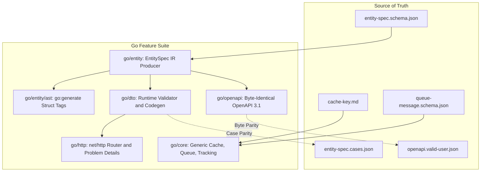

# Specification: Complete Go Feature Suite (F-009)

<div class="callout info">
<strong>Status:</strong> Approved Specification · <strong>Lane:</strong> Go Ecosystem Expansion · <strong>Target Version:</strong> 2.0.8 / 2.1.0 · <strong>Author:</strong> Antigravity & Orchestrator
</div>

<div class="metric-grid">
  <div class="metric-tile success">
    <div class="metric-value">4 Languages</div>
    <div class="metric-label">Full OpenAPI 3.1 Parity</div>
  </div>
  <div class="metric-tile metric">
    <div class="metric-value">100% Cases</div>
    <div class="metric-label">EntitySpec Test Fixture Parity</div>
  </div>
  <div class="metric-tile info">
    <div class="metric-value">Go 1.22+</div>
    <div class="metric-label">Zero 3rd-Party Dependencies</div>
  </div>
  <div class="metric-tile alarm">
    <div class="metric-value">0 Drift</div>
    <div class="metric-label">Byte-Identical Output Assertion</div>
  </div>
</div>

---

## 1. Problem Statement & Motivation

Currently, the **Go** lane in `server-decorator` is limited to an EntitySpec Intermediate Representation (IR) builder (`go/entity`). In contrast, **Node/TypeScript** and **Python** support caching, tracking, queue emission, DTO generation, and OpenAPI generation. **Nim** also supports EntitySpec IR and OpenAPI generation.

This asymmetry leaves Go developers with an incomplete toolchain:
1. Go services cannot automatically emit OpenAPI documentation from their EntitySpec definitions.
2. Go services cannot validate HTTP payloads against EntitySpec DTO rules without manual, duplicate code.
3. Go services cannot share canonical cache keys (`contracts/rules/cache-key.md`) or message queue envelopes (`contracts/schemas/queue-message.schema.json`) with Node and Python services.

---

## 2. Architectural Overview



---

## 3. Subsystem Specifications

### Subsystem A: OpenAPI 3.1 Document Generator (`go/openapi`)

- **Goal**: Generate an OpenAPI 3.1.0 document from `[]entity.EntitySpec` that matches `contracts/fixtures/openapi.valid-user.json` byte-for-byte.
- **Constraints**:
  - Pure standard library (`encoding/json`).
  - Strict key sorting and `SetEscapeHTML(false)`.
  - Full support for RFC 9457 Problem Details (`Problem`, `ValidationProblem`).
  - Path operations matching `contracts/rules/rest-conventions.md`.

### Subsystem B: DTO Validation Engine & Codegen (`go/dto`)

- **Goal**: Evaluate runtime JSON payloads against EntitySpec DTO specifications.
- **Rules**:
  - `create`: Omits `readonly` fields. Rejects unknown properties. Enforces format, pattern, min/max, enum, and required fields.
  - `update`: Omits `readonly` fields. All fields optional. Validates provided fields strictly.
  - `read`: Omits `writeonly` fields.
  - `action`: Validates action-specific input payloads.
- **Test Gate**: Must pass all 25+ test cases in `contracts/fixtures/entity-spec.cases.json`.

### Subsystem C: Core Functional Generics (`go/core`)

- **Goal**: Idiomatic Go 1.18+ Generic higher-order functions for caching, event tracking, and message emission.
- **API Surface**:
  ```go
  func Cache[In any, Out any](adapter CacheAdapter, ttl time.Duration, fn func(context.Context, In) (Out, error)) func(context.Context, In) (Out, error)
  func EmitOnSuccess[In any, Out any](queue QueueAdapter, topic string, fn func(context.Context, In) (Out, error)) func(context.Context, In) (Out, error)
  func Tracking[In any, Out any](key string, fn func(context.Context, In) (Out, error)) func(context.Context, In) (Out, error)
  ```
- **Invariants**:
  - `CACHE_MISS` sentinel:
    ```go
    var CacheMiss = sentinel("server-decorator.cache.miss")
    ```
  - Cache key hashing: Strict conformance to `contracts/rules/cache-key.md` verified against `contracts/fixtures/cache-key.examples.json`.
  - Queue envelope: Matches `contracts/schemas/queue-message.schema.json`.

### Subsystem D: AST Struct-Tag Parser (`go/entity/ast.go`)

- **Goal**: Allow declaring entities as standard Go structs:
  ```go
  // +server-decorator:restful=users
  type User struct {
      ID     int    `entity:"id,readonly"`
      Email  string `entity:"format=email,filterable"`
      Name   string `entity:"min=2,max=80"`
      Status string `entity:"enum=inactive|active|banned"`
  }
  ```
- **Implementation**: Uses `go/parser` and `go/ast` to construct `entity.EntitySpec` with zero reflection at runtime.

### Subsystem E: `net/http` REST Handler Adapter (`go/http`)

- **Goal**: Mount standard `net/http` routes conforming to `rest-conventions.md` with RFC 9457 Problem Details error responses.

---

## 4. Verification Gates

| Phase | Gate Command | Pass Criteria |
| :--- | :--- | :--- |
| **OpenAPI Parity** | `bash scripts/check-openapi-parity.sh` | Output matches `contracts/fixtures/openapi.valid-user.json` with 0 diff bytes. |
| **DTO Cases Parity** | `go test -v ./go/dto/...` | 100% of cases in `entity-spec.cases.json` pass. |
| **Cache Key Parity** | `go test -v ./go/core/...` | 100% of golden examples in `cache-key.examples.json` pass. |
| **Contributor Gate** | `bash scripts/contributor-check.sh` | All 5 repository verification stages pass cleanly. |
