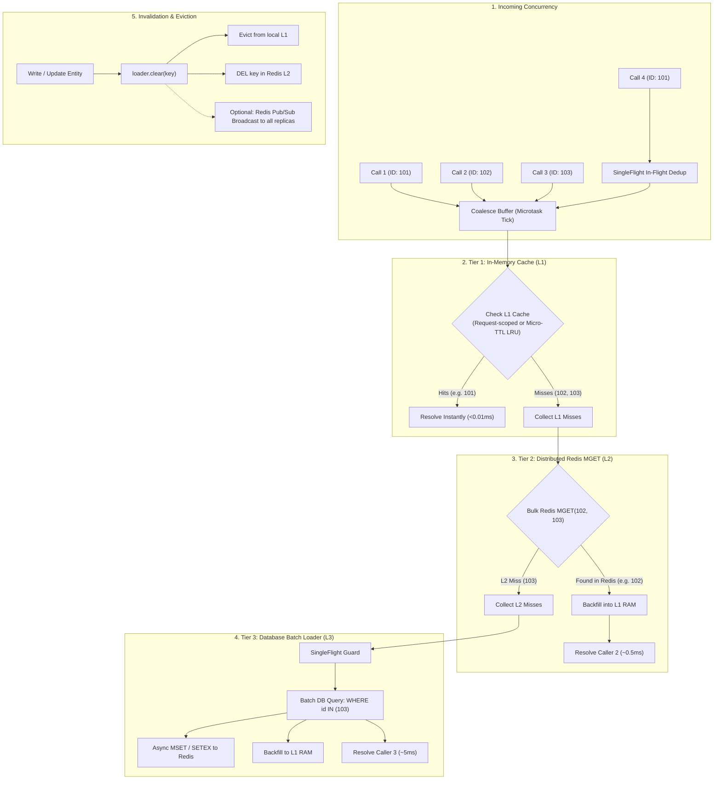

# Multi-Tier Call Coalescing: L1 Memory, L2 Redis MGET, and L3 Batch Loading

## 1. Problem & Context

While `F-014` introduced reactive call coalescing (DataLoader) and in-flight deduplication (SingleFlight), high-concurrency systems face critical challenges when scaling read paths:

1. **Redis Round-Trip Overhead**: When caching entities in Redis, evaluating lookups key-by-key (`GET id1`, `GET id2`, ...) saturates network sockets and increases latency, compared to pipelined bulk commands (`MGET id1 id2 ...`).
2. **Redundant Network Hops for Hot Keys**: Hot keys queried hundreds of times per second across concurrent requests still incur 0.5ms–2ms Redis round-trips if only remote caching is used.
3. **Cache Stampedes / Dog-piling**: When a key expires from Redis, hundreds of simultaneous incoming requests burst through to the source database.
4. **Stale Data Risks in Multi-Replica Environments**: When local in-memory caching (L1) is used without clear boundaries, replicas risk serving outdated data after a write occurs on another instance.

---

## 2. Multi-Tier Architecture & Consistency Models

To balance ultra-low latency with strict data correctness, `F-015` introduces **Multi-Tier Coalescing** supporting three distinct consistency profiles:



---

## 3. Consistency Profiles & Stale Data Prevention

### Profile 1: Request-Scoped (Default — 100% Stale-Free)
- **Scope**: L1 cache is strictly scoped to the active HTTP request context (via `AsyncLocalStorage` in Node, `ContextVar` in Python, or per-request context in Go).
- **Staleness**: **0 ms**. Eliminates N+1 queries within the request; subsequent requests always read fresh data from Redis/DB.

### Profile 2: Micro-TTL LRU (Bounded Eventual Consistency)
- **Scope**: Process-wide bounded LRU with short micro-TTL (500ms–5s).
- **Staleness**: Max $\le \text{TTL}$. Slashes Redis load by >90% during flash crowds or hot-key traffic bursts.

### Profile 3: Active Invalidation (`clear` & Invalidation Bus)
- **Scope**: When an entity is mutated or deleted:
  - Calling `loader.clear(key)` or `loader.clearAll()` immediately purges the key from local L1 and Redis L2.
  - Optional Redis Pub/Sub listener drops the key across all replica L1 instances within 1–2ms.

---

## 4. Key Design Decisions

### D1: Multi-Tier State Machine
When a batch of keys `[K1, K2, ... Kn]` is dispatched:
1. **L1 Scan**: Filter keys against local in-memory cache. Found items immediately resolve their respective callers.
2. **L2 Bulk Fetch**: If `L1_misses` is non-empty and an L2 adapter (Redis) is configured:
   - Call `L2.mget(L1_misses)`.
   - Found keys are backfilled into L1 and resolve their respective callers.
3. **L3 Batch Query**: If `L2_misses` is non-empty:
   - Execute `BatchFn(L2_misses)` under SingleFlight deduplication.
   - For found entities: asynchronously write to L2 (`MSET` with `L2_TTL`), store in L1, and resolve callers.
   - For missing entities: store a negative-cache sentinel in L1/L2 with a short TTL (e.g. 10s) to prevent cache penetration.

### D2: Bounded Memory & LRU Eviction
- L1 cache must be strictly bounded by entry count (`maxEntries`, e.g., 5,000–50,000 items) to prevent memory leaks.
- Items are evicted via Least Recently Used (LRU) policy upon reaching capacity.

### D3: Pure Standard Library in Go
- The Go implementation must remain **100% pure standard library** with zero external dependencies in `go.mod`.
- The L2 cache is defined as an interface (`MGetCache` / `MSetCache`), allowing users to plug in `go-redis`, `valkey-go`, or custom adapters without pulling dependencies into root `go.mod`.

---

## 5. Polyglot Interface Contracts

### 5.1 Go Core: `coalesce.MultiTierLoader`
```go
type MGetCache interface {
    MGet(ctx context.Context, keys []string) (map[string][]byte, error)
    MSet(ctx context.Context, items map[string][]byte, ttl time.Duration) error
    Delete(ctx context.Context, keys ...string) error
}

type MultiTierConfig[K comparable, V any] struct {
    L1Capacity   int           // Max items in local RAM (e.g. 10000; 0 = request/window only)
    L1TTL        time.Duration // Local RAM TTL (0 = tick-only)
    L2Cache      MGetCache     // Interface providing MGet and MSet
    L2TTL        time.Duration // Distributed cache TTL (e.g. 5m)
    MaxBatchSize int           // Batch size limit (default 100)
    BatchTimeout time.Duration // Window duration (e.g. 1ms)
    KeyToString  func(K) string
    BatchFn      func(ctx context.Context, keys []K) (map[K]V, error)
    Serialize    func(V) ([]byte, error)
    Deserialize  func([]byte) (V, error)
}
```

### 5.2 TypeScript / Node: `@batchLoad({ cache: { ... } })`
```typescript
@batchLoad({
  batchMethod: 'findUsersFromDb',
  cache: {
    l1: { maxEntries: 10000, ttlMs: 5000 }, // Optional process LRU, or defaults to request scope
    l2: { adapter: redisAdapter, ttlSeconds: 300 },
  },
})
async findUserById(id: string): Promise<User | undefined> {
  return undefined;
}
```

### 5.3 Python: `@batch_load(l1_max_size=..., l2_cache=...)`
```python
@batch_load(
    batch_method="find_users_from_db",
    l1_max_size=10000,
    l1_ttl_seconds=5,
    l2_cache=redis_adapter,
    l2_ttl_seconds=300,
)
async def find_user_by_id(self, user_id: str) -> User | None:
    return None
```

---

## 6. Verification & Quality Gates
- **Unit Tests**:
  - L1 hit skips L2 and L3 completely.
  - L1 miss + L2 hit backfills L1 and skips L3.
  - L1 miss + L2 miss executes L3 batch query and populates both L1 and L2.
  - SingleFlight prevents concurrent duplicate L3 executions.
  - Explicit eviction via `Clear(key)` purges from L1 and L2.
  - Bounded LRU properly evicts oldest items when capacity is exceeded.
- **Contributor Quality Gate**:
  - Full pass on `scripts/contributor-check.sh` (7/7 gates).
