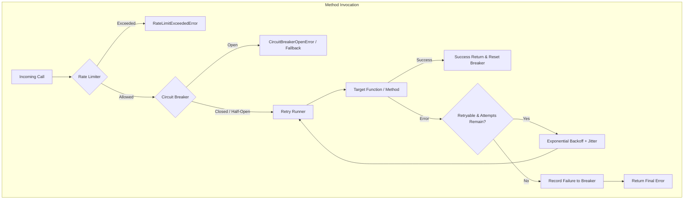

# Polyglot Resilience Suite: @retry, @circuit_breaker, @rate_limit & Property Wrapping

## Goal
Implement a production-grade, polyglot resilience suite across Go, Node/TypeScript, and Python providing declarative retry with exponential backoff & jitter, a three-state circuit breaker, a token-bucket rate limiter, and Python @property wrapping (N1).

<strong>Core Resilience Primitives</strong>
This specification introduces four tightly integrated resilience capabilities with strict cross-runtime semantics across Go (pure standard library, zero external dependencies), Node/TypeScript (Promise + sync handling), and Python (sync + async coroutine support).

---

## 1. Architecture Overview

---

## 2. Component Specifications

### 2.1 `@retry` (Exponential Backoff + Full Jitter)

- **Parameters**:
  - `max_attempts` (default `3`): Total invocation attempts (1 initial + up to 2 retries).
  - `initial_interval_ms` / `backoff_ms` (default `100ms`): Starting backoff delay.
  - `max_interval_ms` / `max_backoff_ms` (default `2000ms`): Maximum cap for delay.
  - `multiplier` / `factor` (default `2.0`): Exponential growth factor.
  - `jitter` (default `true`): Full jitter formula: `delay = uniform_random(0, min(max_interval, initial * (multiplier ^ attempt)))`.
  - `retry_if` / predicate (default `nil` / all non-nil errors).
- **Semantics**:
  - **Go**: `core.Retry[In, Out any](opts RetryOptions, fn func(context.Context, In) (Out, error))` respects `ctx.Done()`.
  - **Node/TypeScript**: `@retry(options)` wraps methods, seamlessly handling async Promises and sync functions.
  - **Python**: `@retry(...)` and `@retry_class(...)` wrap `def` (via `time.sleep`) and `async def` (via `asyncio.sleep`).

### 2.2 `@circuit_breaker` (3-State Machine)

- **States**:
  - `CLOSED`: Target is healthy. All requests pass through. Consecutive failures increment. If `failure_count >= failure_threshold`, state transitions to `OPEN` and records transition timestamp.
  - `OPEN`: Fast fail. Any incoming request immediately returns `CircuitBreakerOpenError` (or invokes `fallback` if supplied) without touching target. If `now - transition_time >= recovery_timeout_ms`, state transitions to `HALF_OPEN`.
  - `HALF_OPEN`: Probe state. Allows trial requests. If trial succeeds, `success_count` increments; when `success_count >= half_open_success_threshold`, transitions back to `CLOSED`. If any trial fails, transitions immediately back to `OPEN`.
- **Parameters**:
  - `failure_threshold` (default `5`)
  - `recovery_timeout_ms` (default `5000ms`)
  - `half_open_success_threshold` (default `2`)
  - `fallback` (optional function: `(err, ...args) -> fallback_result`)
  - `name` / `qualname` (identifier for registry & state metrics)

### 2.3 `@rate_limit` (Token Bucket Algorithm)

- **Parameters**:
  - `capacity` (default `10`): Maximum burst tokens in bucket.
  - `refill_rate` (default `5.0` tokens/sec): Continuous refill speed.
  - `cost` (default `1` token per call).
- **Behavior**:
  - When invoked, calculates `elapsed_time` since `last_refill`.
  - Refills bucket: `tokens = min(capacity, tokens + elapsed_time * refill_rate)`.
  - If `tokens >= cost`, consumes tokens and forwards call.
  - If `tokens < cost`, immediately raises `RateLimitExceededError` / `ErrRateLimitExceeded`.

### 2.4 Python `@property` Wrapping (Decision N1)

- In `_class_apply.py`:
  - When `wrap_properties=True`, if `isinstance(attr, property)`, wrap `fget`, `fset`, and `fdel` methods with `method_decorator` and reconstruct a new `property` object on the class.
  - Preserves property docstrings and descriptor protocol.

---

## 3. Test Plan & Acceptance Criteria

1. **Go Tests (`go/core`)**:
   - `retry_test.go`: Verify attempt count, backoff delays, context cancellation, retry predicate.
   - `circuit_breaker_test.go`: Verify Closed -> Open -> Half-Open -> Closed state transitions, fast-fail rejection, fallback.
   - `rate_limit_test.go`: Verify token bucket capacity, refill over time, burst allowance, limit rejection.
2. **Node Tests (`node/packages/core`)**:
   - `retry.spec.ts`: Unit tests for async & sync methods, max attempts, backoff timing.
   - `circuit-breaker.spec.ts`: Unit tests for state machine, fast-fail, fallback callback.
   - `rate-limit.spec.ts`: Unit tests for token bucket burst and exhaustion.
3. **Python Tests (`python/packages/core`)**:
   - `test_retry.py`: Sync & async retries, exponential backoff, jitter, class decorator `@retry_class`.
   - `test_circuit_breaker.py`: 3-state transitions, fallback function, `@circuit_breaker_class`.
   - `test_rate_limit.py`: Token bucket rate limiting, `@rate_limit_class`.
   - `test_property_wrapping.py`: Assert `wrap_properties=True` decorates `@property` getters and setters (N1).
4. **Website Documentation**:
   - New guide `website/src/content/docs/core/resilience.mdx` with cross-language examples.
5. **Quality Gates**:
   - `bash scripts/contributor-check.sh` passes 7/7 gates cleanly.
