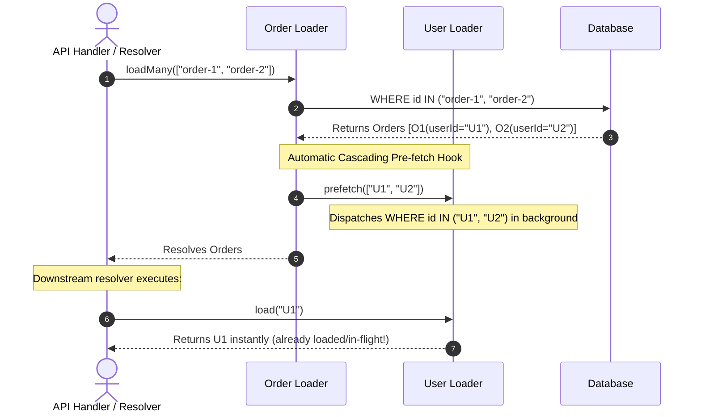

# Cascading Graph Pre-Fetching & Relational Batch Priming

## 1. Problem & Context

While `F-014` and `F-015` established reactive call coalescing, SingleFlight deduplication, and multi-tier L1/L2 caching, relational data graphs still suffer from **Serial Waterfall Cascades**:

```
Client Request
      │
      ▼
┌──────────────┐ (5ms)
│ Fetch Orders │ ──▶ Resolves 20 Orders
└──────────────┘
      │
      ▼ (Wait for Orders to complete)
┌──────────────┐ (5ms)
│ Fetch Users  │ ──▶ Resolves 20 Users via order.userId
└──────────────┘
      │
      ▼ (Wait for Users to complete)
┌──────────────┐ (5ms)
│ Fetch Items  │ ──▶ Resolves Items via order.itemIds
└──────────────┘
Total Latency: 5ms + 5ms + 5ms = 15ms (Serial Waterfall)
```

Even though each step uses a bulk query (e.g. `WHERE id IN (...)`), the child batches cannot begin until the parent batch finishes execution and returns control to downstream resolvers.

---

## 2. The Solution: Declarative Graph Pre-fetching

`F-016` introduces **Cascading Graph Pre-fetching (Stage 4)**:
When parent entities resolve in a batch, foreign keys are immediately extracted and forwarded to child loaders to start fetching or priming in the **same microtask tick**, before downstream resolvers even invoke them.



---

## 3. Key Design Decisions

### D1: Non-Blocking Background Pre-fetch
- Graph pre-fetching executes asynchronously and never blocks the resolution of the parent entity.
- If a child pre-fetch fails, the error is handled gracefully or re-attempted when the child loader is directly called, preventing parent query failures from cascading errors.

### D2: Declarative Hook Specification
- Developers declare child relationships using an `extract` function and a target loader reference:
  - Supports 1-to-1 relations: `(order) => order.userId`
  - Supports 1-to-many relations: `(order) => order.itemIds` (returns array of keys)

### D3: Cache Priming vs Eager Execution
- If a child entity is already embedded in the parent response (e.g. SQL JOIN), calling `targetLoader.prime(key, value)` immediately populates L1/L2 without triggering any query.
- If only the foreign key is present, `targetLoader.prefetch(keys)` immediately schedules a batch lookup.

---

## 4. Polyglot Interface Contracts

### 4.1 Go: `coalesce.GraphLoader` / `PrefetchHook`
```go
type PrefetchRelation[P any, K comparable] struct {
    ExtractKeys func(P) []K
    Prefetch    func(ctx context.Context, keys []K)
}
```

### 4.2 TypeScript: `@batchLoad({ prefetch: [...] })`
```typescript
@batchLoad({
  batchMethod: 'findOrders',
  prefetch: [
    {
      extract: (order: Order) => order.userId,
      loader: () => userService.findUserById,
    },
    {
      extract: (order: Order) => order.itemIds, // array of IDs
      loader: () => itemService.findItemById,
    },
  ],
})
async findOrderById(id: string): Promise<Order | undefined> {
  return undefined;
}
```

### 4.3 Python: `@batch_load(prefetch=[...])`
```python
@batch_load(
    batch_method="find_orders",
    prefetch=[
        {"extract": lambda o: o.user_id, "loader": lambda: user_service.find_user_by_id},
        {"extract": lambda o: o.item_ids, "loader": lambda: item_service.find_item_by_id},
    ],
)
async def find_order_by_id(self, order_id: str) -> Order | None:
    return None
```

---

## 5. Verification
- Parent resolution automatically triggers pre-fetching of child keys.
- Downstream lookup for pre-fetched child key resolves without secondary query latency.
- Support both scalar key (`userId`) and array of keys (`itemIds`).
- Contributor check passes all 7 quality gates.
