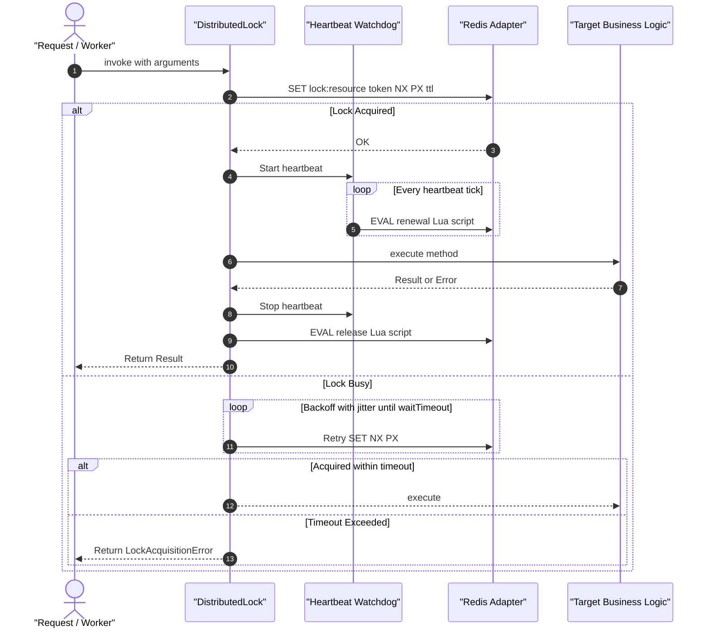

# Redis Distributed Lock Decorator: Polyglot Mutual Exclusion

## 1. Problem & Context

In distributed microservices, concurrent executions of critical sections (such as payment processing, inventory reservation, scheduled cron jobs, or batch ETL runs) across multiple application instances can lead to race conditions, double-spending, and state corruption.

Existing in-memory locks (such as Go `sync.Mutex` or Node.js in-process semaphores) cannot coordinate across distinct processes, containers, or cluster replicas. Developers typically resort to hand-rolled Redis `SET key value NX PX` scripts, often introducing well-known pitfalls:
1. **Premature Lock Expiration**: Long-running operations exceeding the lock TTL lose the lock while still executing, allowing a second instance to acquire it concurrently.
2. **Unsafe Releases**: Releasing a lock after its TTL has expired without verifying ownership can accidentally delete a lock acquired by another worker.
3. **Deadlocks & Starvation**: Lack of acquisition timeouts, exponential jittered retries, and automatic cleanup on process crashes.

> [!NOTE]
> This decorator implements the standard single-instance Redis distributed lock algorithm with monotonic token validation and atomic Lua scripts. It does not implement multi-master Redlock quorum consensus; for systems requiring distributed consensus across multiple independent Redis masters, a specialized cluster coordinator is recommended.

---

## 2. Architecture & Design

`F-019` introduces `@distributedLock` (Node/TS), `@distributed_lock` and `@distributed_lock_class` (Python), and `distlock.Locker` (Go):



---

## 3. Polyglot API Contracts

### A. Core Adapter Contract (Dependency-Free)
All three language runtimes interact with Redis strictly through a lightweight, dependency-free adapter interface:

```typescript
export interface RedisLockAdapter {
  setNxPx(key: string, value: string, ttlMs: number): Promise<boolean>;
  evalLua(script: string, keys: string[], args: (string | number)[]): Promise<any>;
}
```

### B. TypeScript / Node.js
```typescript
export interface DistributedLockOptions {
  /**
   * Lock key or dynamic key generator function from arguments.
   */
  key: string | ((...args: any[]) => string);
  /**
   * Lock lease duration in milliseconds. Default: 10,000ms (10s).
   */
  ttlMs?: number;
  /**
   * Maximum duration in milliseconds to wait to acquire the lock. Default: 0 (fail fast).
   */
  waitTimeoutMs?: number;
  /**
   * Retry backoff interval in milliseconds. Default: 100ms.
   */
  retryIntervalMs?: number;
  /**
   * Enable automatic lock renewal watchdog. Default: true.
   * When enabled, an unref'd timer extends the lock TTL every ttlMs / 3.
   */
  autoRenew?: boolean;
  /**
   * Optional fallback method or value when lock cannot be acquired within waitTimeout.
   */
  fallback?: (...args: any[]) => any;
  /**
   * Redis lock adapter. Required or set via configureDistributedLock({ adapter }).
   */
  adapter?: RedisLockAdapter;
}

export function distributedLock(options: DistributedLockOptions): MethodDecorator;
export function configureDistributedLock(config: { adapter: RedisLockAdapter }): void;
```

### C. Python (Asyncio)
```python
class RedisLockAdapter(Protocol):
    async def set_nx_px(self, key: str, value: str, ttl_ms: int) -> bool: ...
    async def eval_lua(self, script: str, keys: list[str], args: list[str | int]) -> Any: ...

@distributed_lock(
    key=lambda user_id, amount: f"lock:wallet:{user_id}",
    ttl_seconds=10.0,
    wait_timeout_seconds=2.0,
    retry_interval_seconds=0.1,
    auto_renew=True,
    adapter=my_redis_adapter,
)
async def process_payout(user_id: str, amount: float) -> Receipt:
    ...

# Class-level decorator for class-wide method locking (Decision #4 & N4)
@distributed_lock_class(prefix="lock:service", ttl_seconds=5.0)
class PaymentService:
    ...
```

### D. Go (Standard Library Only)
Following the Go stdlib-only constraint ([CLAUDE.md](file:///Users/pasitnusso/workspace/repos/node-server-decorator/CLAUDE.md)), Go defines a zero-dependency interface:

```go
package distlock

type RedisClient interface {
    SetNX(ctx context.Context, key string, value string, ttl time.Duration) (bool, error)
    Eval(ctx context.Context, script string, keys []string, args ...any) (any, error)
}

type Config struct {
    Client          RedisClient
    DefaultTTL      time.Duration
    AutoRenew       bool
    RetryInterval   time.Duration
}

type Locker struct { ... }

func New(cfg Config) *Locker
func (l *Locker) Acquire(ctx context.Context, key string, opts ...Option) (Lock, error)
```

---

## 4. Safety Guarantees & Lua Scripts

1. **Atomic Acquisition**: `SET resource_key token NX PX ttl_ms`
2. **Safe Release**:
   ```lua
   if redis.call("get", KEYS[1]) == ARGV[1] then
       return redis.call("del", KEYS[1])
   else
       return 0
   end
   ```
3. **Safe Renewal**:
   ```lua
   if redis.call("get", KEYS[1]) == ARGV[1] then
       return redis.call("pexpire", KEYS[1], ARGV[2])
   else
       return 0
   end
   ```
4. **Watchdog Failure Handling**: If renewal returns 0 or fails, the watchdog triggers a cancellation signal or logs a critical warning, failing closed rather than assuming ownership.

---

## 5. Verification & Testing Strategy
- **Unit tests with in-memory mock Redis adapters**: Test acquire success, safe release with token verification, rejected release on token mismatch.
- **Mutual exclusion contention tests**: 50 concurrent callers contending for 1 resource; verify that at most 1 execution occurs concurrently and no deadlocks occur.
- **Heartbeat watchdog test**: Method execution duration 3x longer than initial TTL; verify lock remains continuously held until completion, then releases cleanly.
