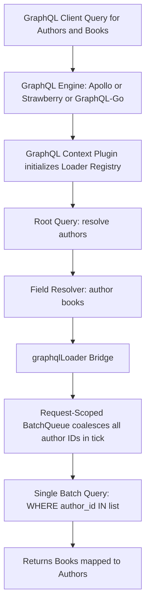

# GraphQL DataLoader Adapter: Seamless GraphQL Batch Resolution & N+1 Prevention

## 1. Problem & Context

GraphQL resolvers are notorious for the **N+1 query problem**. In nested schema queries (e.g. querying a list of authors and each author's books), the field resolver for `author.books` executes once for each author in the parent list, generating $N$ downstream database queries.

While our `@batchLoad` (TypeScript), `@batch_load` (Python), and `coalesce.MultiTierLoader` (Go) engines handle microtask coalescing, GraphQL servers have specific execution lifecycles:
1. **Request Scoping**: DataLoaders must be scoped per HTTP request so cache hits do not leak user-specific data across concurrent client requests.
2. **Context Injection**: GraphQL execution engines (Apollo Server, Mercurius, Strawberry, GraphQL-Go) inject custom context objects (`ctx.loaders` or `info.context`) into field resolvers.
3. **Field Resolver Signature Mismatch**: GraphQL field resolvers receive `(parent, args, context, info)` rather than raw keys, requiring glue code to bind methods to request-scoped loaders.

---

## 2. Architecture & Design

`F-021` introduces `@graphqlLoader` and framework context plugins to bridge existing `@batchLoad` / `@batch_load` decorators directly into GraphQL resolvers:



---

## 3. Polyglot API Contracts

### A. TypeScript / Apollo Server & Mercurius
```typescript
import { createGraphQLLoaderContext, graphqlLoader } from '@montionugera/server-decorator/graphql';

// In GraphQL context setup:
const server = new ApolloServer({
  typeDefs,
  resolvers,
  context: async ({ req }) => ({
    ...createGraphQLLoaderContext(), // creates request-scoped loader registry
  }),
});

// In Resolver:
export const resolvers = {
  Author: {
    books: graphqlLoader({
      service: BookService,
      method: 'findBooksByAuthorId',
      key: (author) => author.id,
    }),
  },
};
```

### B. Python / Strawberry & Ariadne
```python
from server_decorator.graphql import create_graphql_loader_context, graphql_loader

@strawberry.type
class Author:
    id: str
    name: str

    @strawberry.field
    @graphql_loader(
        service=BookService,
        method="find_books_by_author_id",
        key=lambda self: self.id,
    )
    async def books(self) -> list[Book]:
        ...
```

### C. Go / GraphQL-Go & gqlgen
```go
func (r *authorResolver) Books(ctx context.Context, obj *model.Author) ([]*model.Book, error) {
    loader := gqlloader.ForContext(ctx).Get("BookService.FindBooksByAuthorID")
    return loader.Load(ctx, obj.ID)
}
```

---

## 4. Key Capabilities & Safety Controls
1. **Automatic Context Scope Lifecycle**:
   - Creates a clean, isolated batch queue and L1 cache per GraphQL operation.
   - Cleans up upon completion of the GraphQL execution pipeline to prevent memory leaks.
2. **Support for 1-to-1 and 1-to-Many Relationships**:
   - Transparent handling of scalar lookups (`Book.author -> Author`) and list lookups (`Author.books -> Book[]`).
3. **Full Integration with Cascading Prefetch & Multi-Tier Caching**:
   - Resolver loaders inherit L2 Redis MGET caching and prefetch hooks configured on underlying `@batchLoad` definitions.

---

## 5. Verification Strategy
- Integration tests with Apollo Server, Strawberry, and gqlgen executing nested queries (e.g. 50 authors with 5 books each).
- Verify exactly **2 SQL / DB queries** executed (1 for authors, 1 for books) instead of 51 queries.
- Verify request-scope isolation: two concurrent client requests querying identical entities do not share or corrupt request context.
