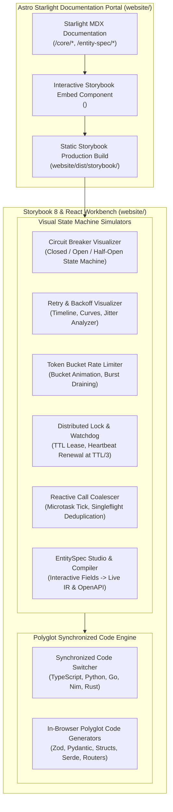

# Storybook-Like Interactive Live Docs & Tutorial Studio Architecture Specification

**File**: `docs/superpowers/specs/2026-10-07-storybook-live-docs-design.md`  
**Status**: Approved Design · Production-Grade Architecture  
**Execution Mode**: OpenUltraCode / Subagent-Driven Full Chain  
**Quality Gate**: Visual validation, structural score 0, zero build regressions across 8 contributor gates  

---

## 1. System Vision & Architecture

`node-server-decorator` is a polyglot microservice framework bridging **Node/TypeScript, Python, Go, Nim, and Rust**.
While traditional documentation presents static code snippets, backend developers evaluating resilience patterns, distributed locks, call coalescing, and EntitySpec compilation need an **interactive, visual, stateful testbed** to observe how decorators behave under failure, concurrency, and rate limits.

This specification introduces the **Server-Decorator Interactive Studio & Tutorial Suite**: a Storybook 8-powered workbench embedded seamlessly inside the existing Astro Starlight documentation portal (`website/`).

---

## 2. Decoupled Architecture Flows

### 2.1 Fast Interactive Simulation Flow (Runtime State Machine)
The simulation loop runs entirely in the browser using client-side reactive state machines:
1. **Event Dispatcher**: User triggers mock requests (e.g. `Success 200`, `Error 500`, `Timeout`, `Burst Request x10`).
2. **State Machine Evaluator**:
   - For Circuit Breaker: Tracks rolling window error counters, transitions states (`CLOSED` → `OPEN` → `HALF-OPEN` → `CLOSED`), controls cooldown timers.
   - For Rate Limiter: Simulates token bucket leakage and replenishment based on elapsed high-resolution timestamps.
   - For Distributed Lock: Simulates Redis key TTL expiration and background watchdog heartbeat renewal at `ttl / 3`.
3. **Canvas & SVG Telemetry**: Renders live animated curves, token count water-levels, and timeline bars with millisecond precision.

### 2.2 Deep Schema & Code Generation Pipeline (EntitySpec Studio)
1. **Schema Editor**: User adds fields, constraints (min, max, pattern, format), actions, and security requirements.
2. **Canonical Serializer**: Renders the exact Canonical JSON IR matching `contracts/rules/entity-spec-canonical.md`.
3. **Live Compilers**:
   - Compiles IR to **OpenAPI 3.1 JSON**.
   - Generates equivalent DTO code across TypeScript (Zod), Python (Pydantic v2), Go (struct validation tags), and Rust (Serde + validator).
   - Generates HTTP mounting code for Express, FastAPI, Gin, and Axum.

---

## 3. Simulator Specifications

### 3.1 Circuit Breaker Simulator
- **States**:
  - `CLOSED` (Healthy, passes calls, tracks failures).
  - `OPEN` (Tripped, rejects with `CircuitBreakerOpenError`, runs reset timer).
  - `HALF-OPEN` (Trialing, allows canary requests, closes on threshold successes).
- **Interactive Controls (Storybook Args)**:
  - `failureThreshold` (int, default: 3).
  - `resetTimeoutMs` (int, default: 3000).
  - `trialSuccesses` (int, default: 2).
  - `rollingWindowMs` (int, default: 10000).
- **Actions**: Trigger Success, Trigger Failure, Fast-Forward Timeout.

### 3.2 Retry & Backoff Simulator
- **Controls**:
  - `maxAttempts` (1–10, default: 3).
  - `backoffMs` (50–2000, default: 200).
  - `maxBackoffMs` (500–10000, default: 2000).
  - `jitter` (`none` | `full` | `equal` | `decorrelated`).
- **Visuals**: Gantt-chart attempt timeline showing each attempt duration, backoff delay, and total latency.

### 3.3 Token Bucket Rate Limiter Simulator
- **Controls**:
  - `capacity` (tokens, default: 10).
  - `refillRate` (tokens/second, default: 2).
  - `tokensPerCall` (default: 1).
- **Visuals**: Animated water-bucket container with dynamic token fill, request drop drops, and RFC 7807 429 Problem Details modal on exhaustion.

### 3.4 Distributed Lock & Watchdog Simulator
- **Controls**:
  - `lockTtlMs` (default: 3000).
  - `autoRenew` (boolean, default: true).
  - `watchdogPeriodMs` (default: `lockTtlMs / 3`).
- **Visuals**: Dual-timeline showing primary execution progress vs background heartbeat renewal pulses, with an interactive "Simulate Node Crash / Partition" button.

### 3.5 Reactive Call Coalescing / DataLoader Simulator
- **Controls**:
  - `batchWindowMs` (0–50ms).
  - `maxBatchSize` (default: 10).
- **Visuals**: Interactive user cards. Clicking multiple users simultaneously shows their requests entering the microtask event-loop queue, coalescing into a single batched SQL query `SELECT * FROM users WHERE id IN (...)`, and resolving all promises individually.

---

## 4. Polyglot Synchronization Engine

Every story provides a **synchronized code panel** displaying the exact decorator syntax and implementation across all 5 languages:

| Decorator | TypeScript / Node | Python | Go | Nim | Rust |
| :--- | :--- | :--- | :--- | :--- | :--- |
| **Cache** | `@cache({ ttl: 60 })` | `@cache(ttl=60)` | `core.Cache(store, 60*time.Second)` | `cached(store, 60.seconds)` | `with_cache(store, Duration::from_secs(60))` |
| **Circuit Breaker** | `@circuitBreaker({ threshold: 3 })` | `@circuit_breaker(threshold=3)` | `core.CircuitBreaker(opts)` | `circuitBreaker(opts)` | `CircuitBreaker::new(opts)` |
| **Rate Limit** | `@rateLimit({ tokens: 10, interval: 'second' })` | `@rate_limit(tokens=10, interval=1)` | `core.RateLimit(opts)` | `rateLimit(opts)` | `RateLimiter::new(opts)` |
| **Retry** | `@retry({ maxAttempts: 3, backoffMs: 200 })` | `@retry(max_attempts=3, backoff_ms=200)` | `core.Retry(opts)` | `retry(opts)` | `with_retry(opts, f)` |
| **Distributed Lock** | `@distributedLock('lock:key', { ttlMs: 3000 })` | `@distributed_lock("lock:key", ttl_ms=3000)` | `lock.WithLock(ctx, "lock:key", opts)` | `withLock("lock:key", opts)` | `with_distributed_lock("lock:key", opts)` |
| **Coalesce** | `@batchLoad(batchFn)` | `@batch_load(batch_fn)` | `loader.New(batchFn)` | `batchLoad(batchFn)` | `CoalesceLoader::new(batch_fn)` |

---

## 5. Build & Portal Integration

1. **Standalone Storybook Dev Server**:
   - Run `pnpm run storybook` inside `website/` (or `pnpm docs:storybook` at root).
   - Starts Storybook on port `6006` (or `6007` if 6006 is busy, strictly per user rule #6).
2. **Static Production Build**:
   - `pnpm run build:storybook` builds to `website/public/storybook/`.
   - `website/astro.config.mjs` serves `public/storybook/` statically.
   - When building docs (`pnpm docs:build`), Storybook static files are automatically built and copied into `website/dist/storybook/`.
3. **Interactive Embed in Starlight Pages**:
   - An Astro component `<StorybookEmbed storyId="..." />` renders the interactive Storybook component or iframe directly inside documentation pages (`/core/resilience`, `/core/cache`, `/entity-spec/declaration`).

---

## 6. Testing & Quality Gate

- All React components unit-tested with Vitest / Testing Library.
- Storybook builds statically with zero errors.
- `scripts/contributor-check.sh` step 8 (`pnpm build` in `website/`) passes green.
