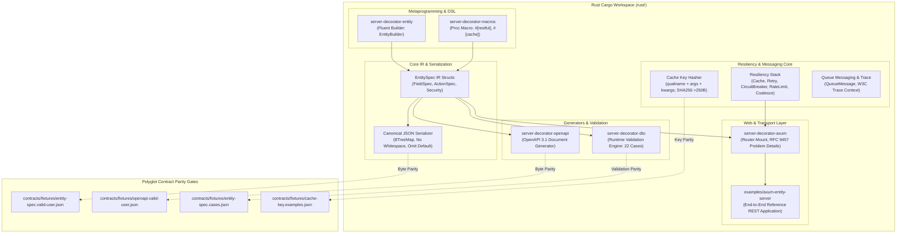

# Rust Lane Architecture Specification: `server-decorator-rust`

**File**: `docs/superpowers/specs/rust-support-design.md`  
**Status**: Approved Design · Production-Grade Architecture  
**Author**: Antigravity Orchestrator (OpenUltraCode Discipline)  
**Parity Target**: Byte-for-byte identical to contracts (`check-entity-parity.sh`, `check-openapi-parity.sh`)  
**Coverage Gate**: >95% line coverage across all packages and E2E project  

---

## 1. System Vision & Architecture

The Rust implementation of `server-decorator` brings high-performance, type-safe, compile-time verified decorators, canonical EntitySpec IR generation, OpenAPI 3.1 compilation, DTO runtime validation, and resiliency primitives to the Rust ecosystem.



---

## 2. Workspace & Crate Structure

The Rust lane is placed under `rust/` in a multi-crate Cargo workspace:

```
rust/
├── Cargo.toml                          # Workspace root
├── crates/
│   ├── server-decorator-core/          # Cache, Retry, CircuitBreaker, RateLimit, Coalesce, QueueMessage, TraceContext
│   ├── server-decorator-entity/        # EntitySpec IR, Builder, Canonical JSON Serializer
│   ├── server-decorator-openapi/       # OpenAPI 3.1 Document Compiler
│   ├── server-decorator-dto/           # Runtime DTO validation engine (cases test)
│   ├── server-decorator-macros/        # Attribute proc-macros (#[restful], #[cache], etc.)
│   └── server-decorator-axum/          # Axum router mounting, error handling (RFC 9457)
└── examples/
    └── axum-entity-server/             # Complete runnable User service with E2E tests
```

---

## 3. Detailed Component Specifications

### 3.1 EntitySpec IR & Canonical Serializer (`server-decorator-entity`)

#### Core Data Structures
```rust
#[derive(Debug, Clone, PartialEq, Eq, Serialize, Deserialize)]
#[serde(rename_all = "camelCase")]
pub struct EntitySpec {
    pub spec_version: String,           // Always "1.2.0"
    pub entity: String,                 // Entity name (e.g. "User")
    pub path: String,                   // URL path (e.g. "users")
    pub transports: Vec<String>,        // ["rest", "rpc", "sse", "ws"]
    pub ops: Vec<String>,               // ["list", "get", "create", "update", "delete"]
    pub pagination: String,             // "offset" | "cursor"
    pub fields: Vec<FieldSpec>,         // In declaration order
    #[serde(skip_serializing_if = "Option::is_none")]
    pub actions: Option<Vec<ActionSpec>>,
    #[serde(skip_serializing_if = "Option::is_none")]
    pub description: Option<String>,
    #[serde(skip_serializing_if = "Option::is_none")]
    pub tags: Option<Vec<String>>,
    #[serde(skip_serializing_if = "Option::is_none")]
    pub security: Option<SecuritySpec>,
}
```

#### Canonical Serialization Rules (`canonical.rs`)
To satisfy `contracts/rules/entity-spec-canonical.md`:
1. **Sorted Keys**: Every JSON object key is sorted lexicographically at every nesting depth via `BTreeMap<String, Value>`.
2. **Compact Separators**: Output produced with `serde_json::to_string` with separators `,` and `:` (no spaces, no trailing newline).
3. **Omit-When-Default**:
   - `optional`, `nullable`, `readonly`, `writeonly`, `filterable` flags only appear if `true`.
   - `transactional` appears only if `false`.
   - `None` fields are omitted.
4. **UTF-8 Clean**: Non-ASCII characters are not unicode-escaped.

### 3.2 OpenAPI 3.1 Document Generator (`server-decorator-openapi`)

Compiles a list of `EntitySpec` into an OpenAPI 3.1 JSON document:
- Paths: `/{path}`, `/{path}/{id}`, `/{path}/{id}/{action}`.
- Components & Schemas:
  - `{Entity}Read` (all readable fields).
  - `{Entity}Create` (writable non-readonly fields; required unless optional/nullable).
  - `{Entity}Update` (writable non-readonly fields; all optional).
  - `{Entity}{Action}Input` (action payload).
- Parameters: Query parameters for `list` (`limit`, `offset`/`cursor`, filterable fields).
- Security Schemes: Http Bearer JWT, API keys, OAuth2 mapped to operations and actions.
- Output: Byte-identical to `contracts/fixtures/openapi.valid-user.json`.

### 3.3 DTO Validation Engine (`server-decorator-dto`)

Implements runtime validation conforming to `contracts/fixtures/entity-spec.cases.json`:
- Supported DTO Types: `create`, `update`, `read`, `action:<name>`.
- Shared Regex Patterns:
  - `EmailPattern`: Shared RFC 5322 regex supporting single-character TLDs.
  - `UuidPattern`: 8-4-4-4-12 hex format.
  - `UriPattern`: Scheme + authority format.
- Constraints:
  - String: `min`, `max`, `pattern` (RE2-safe), `format`, `enum`.
  - Number (`int`, `float`): `min`, `max`. Strict type validation (reject stringified numbers; allow `5.0` as `5` for integer).
  - Datetime: ISO 8601 with timezone offset required; naive datetime rejected. Non-string epochs rejected.
  - Arrays: Item recursive constraints; `min`/`max` items.
  - Objects: Nested property validation.
  - Readonly/Writeonly enforcement: `create` rejects `readonly` fields; `read` strips `writeonly` fields.

### 3.4 Core Resiliency & Cache (`server-decorator-core`)

#### Cache Key Hasher (`cache_key.rs`)
Conforming to `contracts/rules/cache-key.md`:
```rust
pub fn build_cache_key(
    qualname: &str,
    args: &[serde_json::Value],
    kwargs: &BTreeMap<String, serde_json::Value>,
) -> String;
```
1. Serialize args to canonical sorted JSON.
2. Format sorted kwargs as `k=val`.
3. Join with commas: `raw = format!("{qualname}({arg_repr})")`.
4. If `raw.as_bytes().len() <= 250`, return `raw`.
5. Otherwise return `format!("{qualname}(sha256:{digest})")`.

#### Cache Adapter & Sentinel (`cache.rs`)
```rust
#[async_trait]
pub trait CacheAdapter: Send + Sync {
    async fn get(&self, key: &str) -> Result<CacheResult<serde_json::Value>, CacheError>;
    async fn set(&self, key: &str, value: &serde_json::Value, ttl: Duration) -> Result<(), CacheError>;
}

pub enum CacheResult<T> {
    Hit(T),
    Miss,
}
```

#### Resiliency Primitives
- **Retry**: Exponential backoff with jitter and retry predicate (`RetryPolicy`).
- **Circuit Breaker**: Closed, Open, Half-Open state machine with failure rate threshold and reset timeout.
- **Rate Limiter**: Token-bucket / sliding window rate limiting.
- **Batch Loader / Coalesce**: Tokio mpsc-backed batch coalescer with configurable batch window (default 1ms) and max batch size.
- **Distributed Lock**: `LockAdapter` trait with acquire, release, renew.

### 3.5 Messaging & W3C Trace Context

- **QueueMessage**: Strict schema validation (`contracts/schemas/queue-message.schema.json`).
- **Topic Naming**: `<env>.<service>.<event>` (`contracts/rules/topic-naming.md`).
- **Trace Context**: W3C `traceparent` parsing (`00-{trace_id}-{span_id}-{flags}`) and injection into `message.metadata`.

### 3.6 Axum Web Framework Adapter (`server-decorator-axum`)

- Generates an `axum::Router` from an `EntitySpec`.
- Maps CRUD operations:
  - `GET /{path}` -> List with pagination and filter extraction.
  - `GET /{path}/:id` -> Get by ID.
  - `POST /{path}` -> Create with DTO validation.
  - `PUT /{path}/:id` -> Update with DTO validation.
  - `DELETE /{path}/:id` -> Delete by ID.
  - `POST /{path}/:id/:action` -> Custom action handler.
- RFC 9457 Problem Details error formatting.

---

## 4. Verification & Parity Gates

To pass quality gates, the Rust lane must pass:
1. `scripts/check-entity-parity.sh`: Binary `rust/target/release/emit-fixture` outputs byte-identical JSON to `contracts/fixtures/entity-spec.valid-user.json`.
2. `scripts/check-openapi-parity.sh`: Binary `rust/target/release/emit-openapi` outputs byte-identical JSON to `contracts/fixtures/openapi.valid-user.json`.
3. `contracts/fixtures/entity-spec.cases.json`: Unit tests in `server-decorator-dto` pass all 22 cases.
4. `contracts/fixtures/cache-key.examples.json`: Unit tests in `server-decorator-core` pass all golden examples.
5. `scripts/contributor-check.sh`: Step `[4.5/8] Running Rust tests...` runs `cargo test --workspace` and passes 100%.
6. **Coverage Gate**: Code coverage > 95% across all crates.
