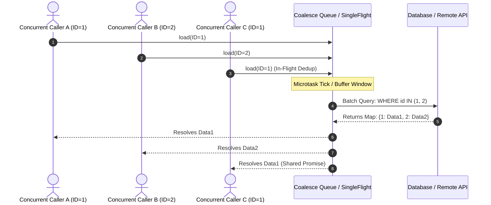

import { Tabs, TabItem } from '@astrojs/starlight/components';

# Reactive Call Coalescing & Batch Loading

When microservices or GraphQL/REST resolvers resolve entities individually (e.g. iterating over a list of items and calling `repo.findById(item.id)`), systems suffer from the **N+1 query problem**, network round-trip overhead, and database connection pool starvation under high concurrency.

The Call Coalescing subsystem transparently intercepts concurrent individual lookups within a microtask tick or fixed time window (e.g., 500µs–2ms) and batches them into a single consolidated bulk operation (e.g., `WHERE id IN (...)` or `MGET`), while concurrently deduplicating identical in-flight keys.



---

## Key Features

- **Microtask Event Loop Coalescing**: By default, lookups queued in the exact same event loop tick (`queueMicrotask` / `process.nextTick` in Node, `call_soon` in Python) coalesce without artificial sleep delays.
- **In-Flight Deduplication (SingleFlight)**: Multiple concurrent callers asking for the same key await the same in-flight future or batch entry, avoiding redundant database lookups.
- **Context Cancellation Isolation**: In Go, individual caller context cancellations do not abort shared batch execution unless all callers abort.
- **Request-Scoped Tenant Isolation**: Pass `AsyncLocalStorage` in Node or `contextvars.ContextVar` in Python to guarantee batch buffers never leak across distinct tenants or request boundaries.

---

## Usage by Language

<Tabs syncKey="lang">
  <TabItem label="TypeScript / Node" icon="seti:typescript">
```typescript
import { batchLoad } from '@montionugera/server-decorator';

export class UserService {
  // Batch loader method that accepts an array of IDs
  async findUsersByIds(ids: string[]): Promise<Map<string, User>> {
    const users = await db.users.findMany({ where: { id: { in: ids } } });
    return new Map(users.map(u => [u.id, u]));
  }

  // Individual lookup method decorated with @batchLoad
  @batchLoad({
    batchMethod: 'findUsersByIds',
    deduplicate: true,
    maxBatchSize: 100,
  })
  async findUserById(id: string): Promise<User | undefined> {
    // Transparently intercepted and dispatched via findUsersByIds
    return undefined;
  }
}
```
  </TabItem>

  <TabItem label="Python" icon="seti:python">
```python
from server_decorator import batch_load

class UserService:
    async def find_users_by_ids(self, ids: list[str]) -> dict[str, dict]:
        # Bulk query executed once
        users = await db.users.find({"_id": {"$in": ids}}).to_list(length=len(ids))
        return {u["_id"]: u for u in users}

    @batch_load(batch_method="find_users_by_ids", deduplicate=True, max_batch_size=100)
    async def find_user_by_id(self, user_id: str) -> dict | None:
        # Transparently coalesced in the same event-loop tick
        return None
```
  </TabItem>

  <TabItem label="Go" icon="seti:go">
```go
package main

import (
    "context"
    "time"

    "github.com/montionugera/node-server-decorator/v2/go/core/coalesce"
)

func main() {
    // Create a pure standard-library coalesce loader
    loader := coalesce.NewLoader(coalesce.LoaderConfig[string, *User]{
        MaxBatchSize: 100,
        BatchTimeout: 1 * time.Millisecond,
        BatchFn: func(ctx context.Context, keys []string) (map[string]*User, error) {
            // Executed once with all keys collected in the window
            return db.FindUsersByIDs(ctx, keys)
        },
    })
    defer loader.Close()

    // Callers load individual keys concurrently:
    user, err := loader.Load(ctx, "user-123")
}
```
  </TabItem>
</Tabs>

---

## Configuration Options

| Option | Type | Default | Description |
|---|---|---|---|
| `maxBatchSize` | `number` / `int` | `100` | Maximum number of keys collected before immediately dispatching a batch. |
| `windowMs` / `BatchTimeout` | `number` / `Duration` | `0` (Microtask tick) | Buffer window duration. If `0`, dispatches on the event loop's microtask tick. |
| `deduplicate` | `boolean` / `bool` | `true` | If true, concurrent lookups for the identical key share the same in-flight promise. |
| `contextStorage` / `context_var` | Object | `None` | Optional request context store (`AsyncLocalStorage` or `ContextVar`) for multi-tenant isolation. |
