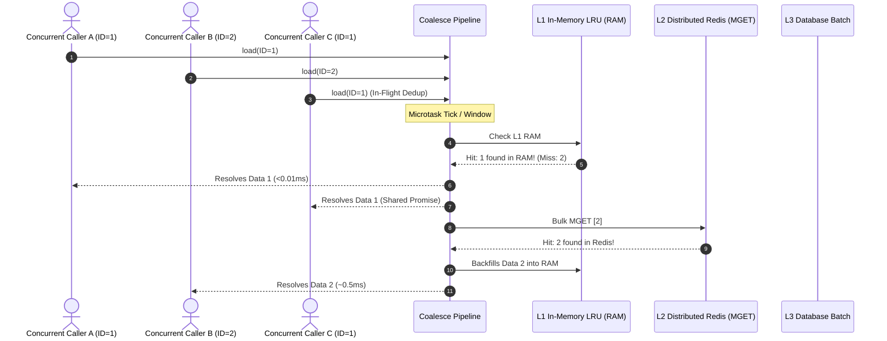
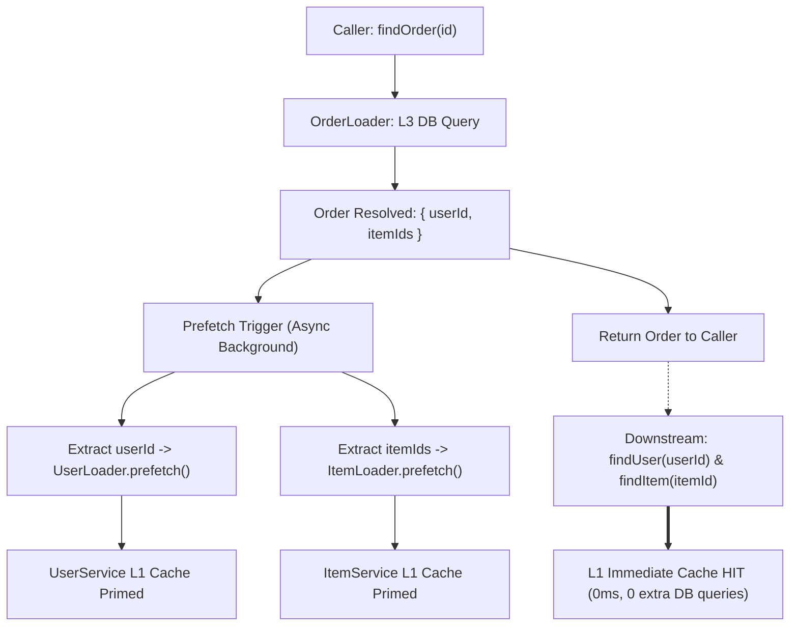

import { Tabs, TabItem } from '@astrojs/starlight/components';

# Reactive Call Coalescing & Multi-Tier Batch Loading

When microservices or resolvers resolve entities individually (e.g. iterating over a list of items and calling `repo.findById(item.id)`), systems suffer from the **N+1 query problem**, network round-trip overhead, and database connection pool starvation under high concurrency.

The Call Coalescing subsystem transparently intercepts concurrent individual lookups within a microtask tick or fixed time window (e.g., 500µs–2ms) and routes them through a coordinated **3-tier read hierarchy**:
`L1 In-Memory LRU ➔ L2 Distributed Redis MGET ➔ L3 Database Batch Query`



---

## Key Features

- **Microtask Event Loop Coalescing**: Lookups queued in the exact same event loop tick (`queueMicrotask` in Node, `call_soon` in Python) coalesce without artificial sleep delays.
- **In-Flight Deduplication (SingleFlight)**: Multiple concurrent callers asking for the same key await the same in-flight future or batch entry, avoiding redundant database or cache lookups.
- **Multi-Tier Caching (L1/L2/L3)**:
  - **L1 RAM**: Microsecond lookups without network hops. Bounded by LRU capacity and micro-TTL.
  - **L2 Redis MGET**: Bulk pipelined read for L1 misses in a single network round-trip.
  - **L3 DB Query**: Fallback for remaining misses (`WHERE id IN (...)`). Automatically backfills L2 and L1.
- **Cache Penetration Defense (Negative Caching)**: Non-existent keys in the database are cached as empty sentinels for a short negative TTL (e.g. 5s) to protect the DB from malicious or high-rate 404 queries.
- **Explicit Cache Eviction**: Call `.clear(key)` on write/delete operations to immediately purge both L1 memory and L2 Redis.

---

## Stale Data Prevention & Consistency Profiles

| Profile | Staleness Window | Invalidation Mechanism | Ideal Use Case |
|---|---|---|---|
| **Request-Scoped (Default)** | **0 ms (Zero)** | L1 is destroyed when request/tick completes | Financial transactions, orders, account balances |
| **Micro-TTL LRU** | **< 1–5 seconds** | Bounded LRU with micro-expiration (e.g. 5s) | High-volume read feeds, product catalogs, public profiles |
| **Active Eviction (`clear`)** | **~1–2 ms** | `method.clear(id)` purges L1 locally + L2 in Redis | Standard CRUD entity repositories on update/delete |

---

## Usage by Language

<Tabs syncKey="lang">
  <TabItem label="TypeScript / Node" icon="seti:typescript">
```typescript
import { batchLoad, MGetCacheAdapter } from '@montionugera/server-decorator';

export class UserService {
  // Batch loader method executed only for true cache misses
  async findUsersByIds(ids: string[]): Promise<Map<string, User>> {
    const users = await db.users.findMany({ where: { id: { in: ids } } });
    return new Map(users.map(u => [u.id, u]));
  }

  // Individual lookup method decorated with @batchLoad and multi-tier cache
  @batchLoad({
    batchMethod: 'findUsersByIds',
    deduplicate: true,
    cache: {
      l1: { maxEntries: 10000, ttlMs: 5000 },
      l2: { adapter: redisAdapter, ttlSeconds: 300 },
      negativeTtlSeconds: 5,
    },
  })
  async findUserById(id: string): Promise<User | undefined> {
    return undefined;
  }

  async updateUser(id: string, data: Partial<User>) {
    await db.users.update({ where: { id }, data });
    // Invalidate L1 and L2 across the cluster
    await (this.findUserById as any).clear(id);
  }
}
```
  </TabItem>

  <TabItem label="Python" icon="seti:python">
```python
from server_decorator import batch_load

class UserService:
    async def find_users_by_ids(self, ids: list[str]) -> dict[str, dict]:
        users = await db.users.find({"_id": {"$in": ids}}).to_list(length=len(ids))
        return {u["_id"]: u for u in users}

    @batch_load(
        batch_method="find_users_by_ids",
        l1_max_size=10000,
        l1_ttl_seconds=5.0,
        l2_cache=redis_adapter,
        l2_ttl_seconds=300.0,
        negative_ttl_seconds=5.0,
    )
    async def find_user_by_id(self, user_id: str) -> dict | None:
        return None

    async def update_user(self, user_id: str, data: dict) -> None:
        await db.users.update_one({"_id": user_id}, {"$set": data})
        # Evict key from L1 and L2
        await self.find_user_by_id.clear(user_id)
```
  </TabItem>

  <TabItem label="Go" icon="seti:go">
```go
package main

import (
    "context"
    "time"

    "github.com/montionugera/node-server-decorator/v2/go/core/coalesce"
)

func main() {
    loader := coalesce.NewMultiTierLoader(coalesce.MultiTierConfig[string, *User]{
        L1Capacity:   10000,
        L1TTL:        5 * time.Second,
        L2Cache:      redisAdapter, // Implements coalesce.MGetCache
        L2TTL:        5 * time.Minute,
        NegativeTTL:  5 * time.Second,
        MaxBatchSize: 100,
        BatchTimeout: 1 * time.Millisecond,
        BatchFn: func(ctx context.Context, missKeys []string) (map[string]*User, error) {
            return db.FindUsersByIDs(ctx, missKeys)
        },
        Serialize:   serializeUser,
        Deserialize: deserializeUser,
    })
    defer loader.Close()

    // Concurrent callers resolve via L1 -> L2 MGET -> L3 DB
    user, err := loader.Load(ctx, "user-123")

    // On mutation, evict from all tiers:
    _ = loader.Clear(ctx, "user-123")
}
```
  </TabItem>
</Tabs>

---

## Configuration Reference

| Option | Type | Default | Description |
|---|---|---|---|
| `maxBatchSize` | `number` / `int` | `100` | Maximum number of keys collected before immediately dispatching a batch. |
| `windowMs` / `BatchTimeout` | `number` / `Duration` | `0` (Microtask tick) | Buffer window duration. If `0`, dispatches on the event loop's microtask tick. |
| `deduplicate` | `boolean` / `bool` | `true` | If true, concurrent lookups for the identical key share the same in-flight promise. |
| `l1.maxEntries` / `L1Capacity` | `number` / `int` | `10000` | Maximum entries retained in local process RAM LRU cache. |
| `l1.ttlMs` / `L1TTL` | `number` / `Duration` | `0` (tick only) | In-memory LRU TTL. Set to small micro-TTL (1–5s) for read-heavy workloads. |
| `l2.adapter` / `L2Cache` | Adapter / Interface | `None` | Distributed cache adapter implementing bulk `mget` and pipelined `setMany`. |
| `negativeTtlSeconds` / `NegativeTTL` | `number` / `Duration` | `5s` | Duration to cache missing/non-existent keys to prevent cache penetration. |
| `prefetch` / `PrefetchHooks` | Rules array / hooks slice | `None` | Rules to extract child relational keys and trigger proactive pre-fetching on resolution. |

---

## Cascading Graph Pre-Fetching & Relational Loader Priming

When querying parent models that reference foreign keys or nested collections (e.g. an `Order` containing `userId` and `itemIds`), applications typically suffer from relational N+1 waterfalls.

With **Cascading Graph Pre-Fetching**, resolving a parent entity automatically triggers proactive background fetches for downstream entities, populating their L1/L2 caches before the application even requests them:



### Relational Priming Across Languages

<Tabs syncKey="lang">
  <TabItem label="TypeScript / Node" icon="seti:typescript">
```typescript
import { batchLoad, PrefetchRule } from '@montionugera/server-decorator';

export class OrderService {
  @batchLoad({
    batchMethod: 'batchOrders',
    prefetch: [
      {
        extract: (order: Order) => order.userId,
        loader: () => userService.findUser.bind(userService),
      },
      {
        extract: (order: Order) => order.itemIds,
        loader: () => itemService.findItem.bind(itemService),
      },
    ],
  })
  async findOrder(id: string): Promise<Order | undefined> {
    return undefined;
  }
}

// Or manually prime a loader when you already have the entity:
(userService.findUser as any).prime('user-1', existingUser);
```
  </TabItem>

  <TabItem label="Python" icon="seti:python">
```python
from server_decorator import batch_load, PrefetchRule

class OrderService:
    @batch_load(
        batch_method="batch_orders",
        prefetch=[
            PrefetchRule(
                extract=lambda o: o["user_id"],
                loader=lambda: user_service.find_user,
            ),
            PrefetchRule(
                extract=lambda o: o["item_ids"],
                loader=lambda: item_service.find_item,
            ),
        ],
    )
    async def find_order(self, order_id: str) -> dict | None:
        return None

# Or manually prime:
user_service.find_user.prime("user-1", existing_user)
```
  </TabItem>

  <TabItem label="Go" icon="seti:go">
```go
orderLoader := coalesce.NewMultiTierLoader(coalesce.MultiTierConfig[string, *Order]{
    BatchFn: db.FindOrdersByIDs,
    PrefetchHooks: []func(ctx context.Context, orders []*Order){
        func(ctx context.Context, orders []*Order) {
            var userIDs []string
            for _, o := range orders {
                userIDs = append(userIDs, o.UserID)
            }
            userLoader.Prefetch(ctx, userIDs)
        },
    },
})

// Or manually prime:
userLoader.Prime("user-1", existingUser)
```
  </TabItem>
</Tabs>

